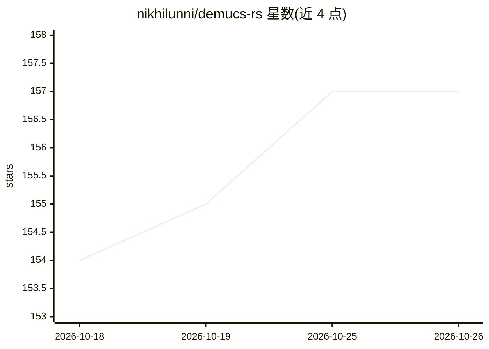

# nikhilunni/demucs-rs

⭐ 157 · Rust · Apache-2.0 · 推送 2026-10-20 · [GitHub](https://github.com/nikhilunni/demucs-rs) · [官网](https://nikhilunni.github.io/demucs-rs/) · 个人维护

**Rust 实现的本地音乐源分离工具：歌曲拆分为鼓/贝斯/人声等音轨**

HTDemucs v4 的原生 Rust 实现，通过 Burn 框架做 GPU 加速推理，把音乐文件拆分为鼓、贝斯、人声等独立音轨。以三种形态提供：原生 CLI（macOS Metal、Linux/Windows Vulkan）、浏览器 Web 应用（WebAssembly + WebGPU，完全本地）、macOS 的 VST3/CLAP DAW 插件（MIDI 触发音轨播放、每音轨辅助输出）。提供三种模型（4 轨/6 轨/微调版），权重首次使用时从 Hugging Face 自动下载。CLI 可作为 MCP server 通过 stdio 供 MCP 客户端调用。WASM 版比原生 CLI 慢，长曲目建议用 CLI。

## 筛选速览

| 维度 | 判定 | 备注 |
|---|---|---|
| AI 角色 | `ai-native` | 本体是模型或模型工具 |
| 许可风险 | `permissive` | Apache-2.0 |
| 部署形态 | `library` | 以包/库形式分发 |
| 模型依赖 | — | README 未给出锁定关系 |
| 硬件要求 | — | 无带数字的原话,不猜 |
| 安装摩擦 | `low` | 无编译、无系统依赖或容器化 |
| 成熟度 | — | 结构信号不足 |

## 能力要点

- 三种模型变体：4 轨标准、6 轨（加吉他和钢琴）、333MB 微调版
- GPU 加速推理：Metal / Vulkan / WebGPU 后端
- VST3/CLAP DAW 插件，支持 MIDI 触发音轨播放与每音轨辅助输出
- CLI 可作为 MCP server 通过 stdio 的 JSON-RPC 2.0 调用

## 适用场景

- 把自己喜欢的歌拆成人声和伴奏音轨
- 在 DAW 里分离音轨并分别路由混音
- 浏览器里拖放音频文件本地完成分离，不上传音频

## 场景标签

 · 领域:音频处理/音乐技术

## 证据(README 行号)

> L9: A native Rust implementation of HTDemucs v4 — state-of-the-art music source separation. Splits any song into individ
> L29: - **GPU accelerated** — Metal, Vulkan, and WebGPU backends via Burn's wgpu support

## 星数曲线

2026-10-18 154 → 2026-10-26 157（+3）

---
*卡片 v1 · prompt 1.4 · 生成 2026-10-22 · 置信度 high · 依据 README sha `b7ef88029343` · [字段定义](../../DATASET.md)*
