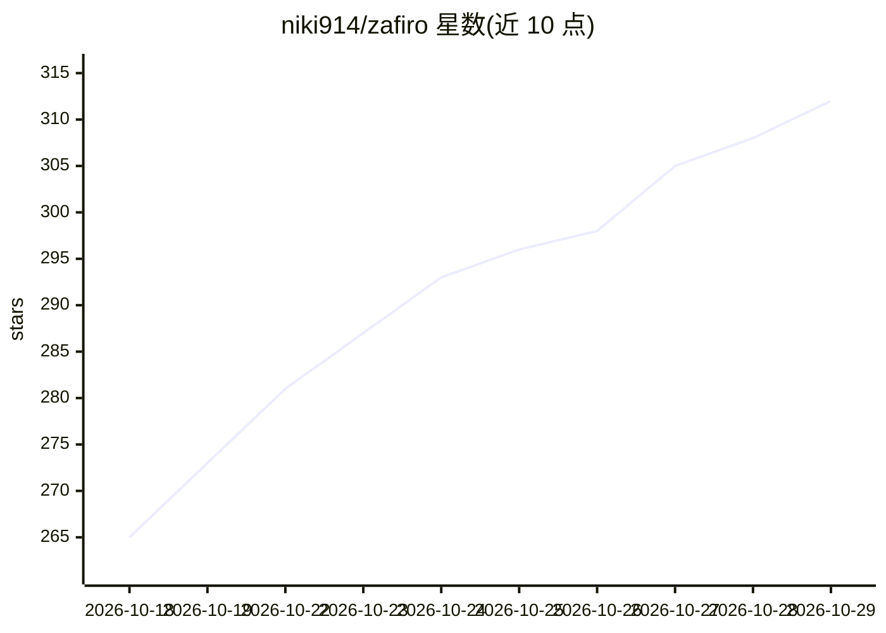

# niki914/zafiro

⭐ 312 · Kotlin · MIT · 推送 2026-10-28 · [GitHub](https://github.com/niki914/zafiro) · 个人维护 · 中文 README

**安卓端 BYOK 开源 AI Agent：控制手机、跑 Shell 与 Python**

运行在 Android 设备上的开源智能 Agent 应用，采用 BYOK 模式自带 LLM API key，内置 OpenAI、Anthropic 之外的 DeepSeek、OpenRouter、Kimi 等多家 Provider 配置。通过 Accessibility Service 或 Shizuku（免 Root）实现自主 GUI 导航与跨应用设备控制，可原生运行 Shell 与 Python 3，支持 Skills、MCP、记忆与会话分支。经 LSPosed 可接管系统语音助手（需 Root，目前支持 OPPO Breeno）。提供 Releases 下载或从源码构建。

## 筛选速览

| 维度 | 判定 | 备注 |
|---|---|---|
| AI 角色 | `ai-native` | 本体是模型或模型工具 |
| 许可风险 | `permissive` | MIT |
| 部署形态 | `None` |  |
| 模型依赖 | locked-api |  |
| 硬件要求 | — | 无带数字的原话,不猜 |
| 安装摩擦 | `medium` | 含编译或系统依赖之一 |
| 成熟度 | — | 结构信号不足 |

## 能力要点

- 通过 Accessibility Service/Shizuku 实现手机屏幕指针控制，Root 体验最全
- 原生运行 Shell 与 Python 3，Agent 可自建并维护工具
- 支持 Skills、MCP、记忆、工作区与本地会话分支
- LSPosed 接管系统语音助手（Breeno/XiaoAi 演示）

## 适用场景

- 用自然语言让 Agent 替我在手机上操作应用、点歌、点餐
- 在手机上运行 Python 工具并通过 SSH 连接远程开发机
- 用自己的 API key 在安卓设备上获得带设备控制能力的 AI 助手

## 场景标签

`AI 助手` `GUI 自动化` · 领域:效率与自动化

## 证据(README 行号)

> L14: Zafiro is an open-source intelligent Agent running on Android devices, with BYOK support. It understands your scree
> L57: - **Out-of-the-Box** - built-in support for OpenAI, Anthropic, Google Gemini, DeepSeek, OpenRouter, Kimi, Alibaba B

## 星数曲线

2026-10-18 265 → 2026-10-29 312（+47）

---
*卡片 v1 · prompt 1.4 · 生成 2026-10-22 · 置信度 high · 依据 README sha `eed5346b681c` · [字段定义](../../DATASET.md)*
