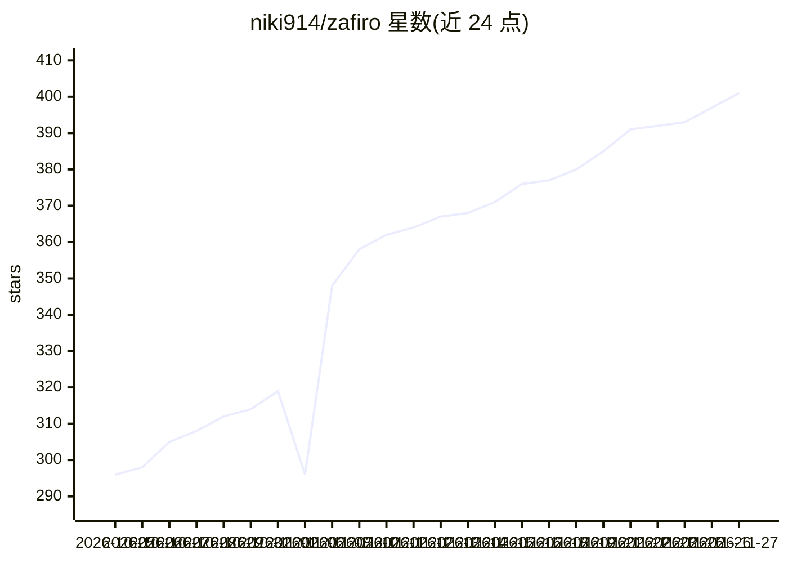

# niki914/zafiro

⭐ 401 · Kotlin · MIT · 推送 2026-11-22 · [GitHub](https://github.com/niki914/zafiro) · 个人维护 · 中文 README

**Android 上的 BYOK AI agent，可操控手机执行任务**

运行于 Android 的 BYOK（自带密钥）agent 应用， Kotlin/Jetpack Compose 构建，Material 3 Expressive 界面。除对话外，可通过 Phone-Use（accessibility 树、截图、手势派发）跨应用执行任务，内置 Shell/SSH 与 Python 3（Chaquopy）运行时，支持 Skills、MCP、记忆与工作区扩展，亦可作为 MCP server 暴露给编程 agent。提供 Release 下载，也可经 Android Studio/Gradle 从源码构建；语音助手接管（Breeno/小爱）需 Root 与 LSPosed。

## 筛选速览

| 维度 | 判定 | 备注 |
|---|---|---|
| AI 角色 | `ai-native` | 本体是模型或模型工具 |
| 许可风险 | `permissive` | MIT |
| 部署形态 | `None` |  |
| 模型依赖 | locked-api |  |
| 硬件要求 | — | 无带数字的原话,不猜 |
| 安装摩擦 | `medium` | 含编译或系统依赖之一 |
| 成熟度 | — | 结构信号不足 |

## 能力要点

- Phone-Use 屏幕交互：打开应用、点歌、下单等后台代操作
- 设备上原生运行 Shell/SSH 与 Python 3，可自封装工具
- BYOK 接入多家模型，支持 Skills/MCP/记忆扩展
- 经 LSPosed 接管系统语音助手（需 Root）

## 适用场景

- 让 agent 代我在手机上完成打开应用、下单等操作
- 在手机端本地跑 Shell/Python 完成开发与自动化任务
- 把手机上的 agent 作为 MCP server 接给我的编程 agent
- 唤醒小爱/Breeno 时改由 Zafiro 应答

## 场景标签

`GUI 自动化` `AI 助手` · 领域:效率与自动化

## 证据(README 行号)

> L25: Zafiro is an intelligent BYOK Agent with elegant UI design, running on Android.
> L27: Zafiro is more than just a chatbot—it can perform tasks across apps through Phone-Use, with full support for Skills
> L41: - **Out-of-the-Box** - built-in BYOK support for OpenAI, Anthropic, Google Gemini, DeepSeek, OpenRouter, etc.

## 星数曲线

2026-10-25 296 → 2026-11-27 401（+105）

---
*卡片 v1 · prompt 1.4 · 生成 2026-11-25 · 置信度 high · 依据 README sha `706ce842dc24` · [字段定义](../../DATASET.md)*
