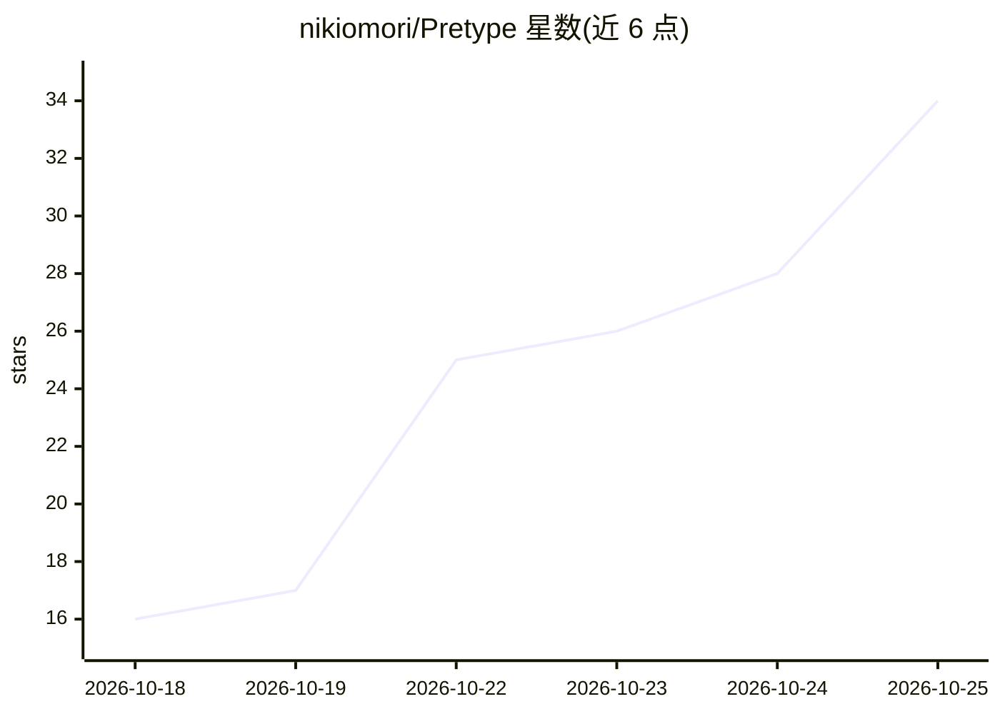

# nikiomori/Pretype

⭐ 34 · Swift · MIT · 推送 2026-10-22 · [GitHub](https://github.com/nikiomori/Pretype) · [官网](https://pretype.app) · 个人维护

**macOS 全系统本地 AI 自动补全：任意文本框中获得 Copilot 式建议**

面向 macOS（Apple Silicon）用户的系统级输入增强应用：在所有文本框（原生、Electron、网页）光标处显示本地模型生成的补全建议，Tab 逐词接受、Shift-Tab 全部接受；另提供拼写修正、基于本地模型的重写与回复草稿、macOS 语音模型转录的听写（可选 Parakeet）。默认本地运行，文本不上传；可选用 OpenAI、Anthropic、Ollama 等 API 提供方。默认模型下载约 1.5–5.3 GB，需 macOS 26+ 与 8 GB 以上内存，需授予辅助功能权限。

## 筛选速览

| 维度 | 判定 | 备注 |
|---|---|---|
| AI 角色 | `ai-native` | 本体是模型或模型工具 |
| 许可风险 | `permissive` | MIT |
| 部署形态 | `desktop` | 安装包/桌面程序 |
| 模型依赖 | local-ok | 支持本地模型 |
| 硬件要求 | — | 无带数字的原话,不猜 |
| 安装摩擦 | `low` | 无编译、无系统依赖或容器化 |
| 成熟度 | — | 结构信号不足 |

## 能力要点

- 本地模型在任意文本框生成补全建议（17–81 ms）
- 重写与回复草稿：本地模型修语法、按屏幕对话起草下一条消息
- macOS 语音模型本地听写，含语音指令与标点整理
- 可选接入 OpenAI/Anthropic/Gemini/Ollama 等托管模型，密钥存钥匙串

## 适用场景

- 在邮件、聊天、编辑器等各类文本框中获得离线补全
- 听写口述并由本地模型整理标点与大小写
- 按应用/网站配置个人文风并共享文风文件

## 场景标签

`AI 写作` `语音识别` `AI 助手` · 领域:对话与助手

## 证据(README 行号)

> L5: **System-wide AI autocomplete for macOS.**
> L67: |**Rewrites** ( ⌥Tab )|The local model fixes grammar, typos, and phrasing. It keeps your tone. The best model fixes
> L74: |**Hosted models** *(optional, off)*|OpenAI, Anthropic, Google Gemini, Groq, Mistral, OpenRouter, DeepSeek, or a lo

## 星数曲线

2026-10-18 16 → 2026-10-25 34（+18）

---
*卡片 v1 · prompt 1.4 · 生成 2026-10-25 · 置信度 high · 依据 README sha `796ea5d2d1bd` · [字段定义](../../DATASET.md)*
