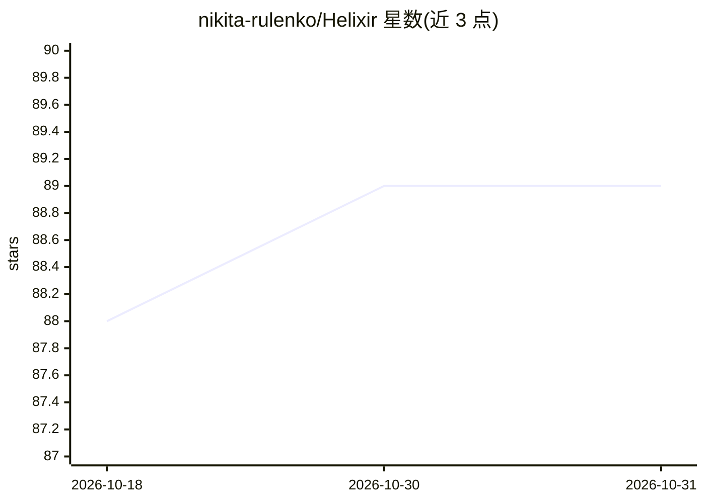

# nikita-rulenko/Helixir

⭐ 89 · Rust · MIT · 推送 2026-08-25 · [GitHub](https://github.com/nikita-rulenko/Helixir) · 个人维护

**给 AI agent 用的跨 harness 持久记忆与治理控制平面**

以 Rust 实现的 MCP 兼容记忆控制平面：将写入内容抽取为原子事实并分类为八种类型，经决策矩阵执行新增/更新/取代/矛盾等操作，构建 HelixDB 存储的推理图；检索融合向量、BM25 与图遍历并用 Personalized PageRank 排序，读取路径不调用生成式 LLM。支持 Codex、Claude Code、Cursor 等 MCP 客户端，通过统一 MCP gateway 接入，RBAC 常开。分为完整宿主包 helixir 与瘦客户端包 helixir-client 两种部署形态，本地路径默认配置 Ollama 的 nomic-embed-text 嵌入。

## 筛选速览

| 维度 | 判定 | 备注 |
|---|---|---|
| AI 角色 | `ai-ecosystem` | LLM/agent 周边工具 |
| 许可风险 | `permissive` | MIT |
| 部署形态 | `None` |  |
| 模型依赖 | local-ok | 支持本地模型 |
| 硬件要求 | — | 无带数字的原话,不猜 |
| 安装摩擦 | `low` | 无编译、无系统依赖或容器化 |
| 成熟度 | — | 结构信号不足 |

## 能力要点

- 写入时原子事实抽取与八类型分类，决策矩阵支持 ADD/UPDATE/SUPERSEDE/CONTRADICT 等转换
- 混合检索：向量 + BM25 + 图遍历 + Personalized PageRank，读取路径无生成式 LLM 调用
- 事件时间窗口检索与跨时间的 flashback 关联结果（metadata.flashback 标注）
- MCP gateway 统一接入 Codex/Claude Code/Cursor，HelixDB 存储 RBAC，暴露 23 个 MCP 工具

## 适用场景

- 让多个 AI agent 客户端共享同一份持久记忆与推理图
- 在时间窗口内检索记忆并保留图关联的跨期上下文
- 对共享记忆按用户/组/角色做权限治理与审计
- 远程机器上的 agent 通过瘦客户端接入中心记忆服务

## 场景标签

`Agent 记忆` · 领域:Agent 开发

## 证据(README 行号)

> L5:  A governed, cross-harness memory control plane for AI agents.
> L10:  MCP compatible
> L51: For Codex, Claude Code, and Cursor, use one managed MCP gateway per host instead

## 星数曲线

2026-10-18 88 → 2026-10-31 89（+1）

---
*卡片 v1 · prompt 1.4 · 生成 2026-10-23 · 置信度 high · 依据 README sha `b587c446efeb` · [字段定义](../../DATASET.md)*
