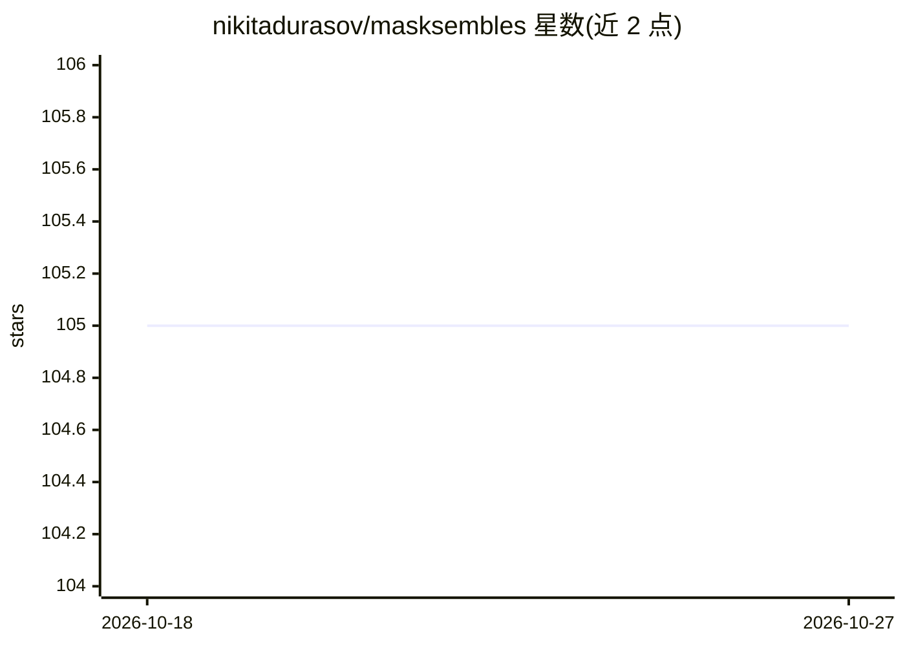

# nikitadurasov/masksembles

⭐ 105 · Python · MIT · 推送 2025-11-09 · [GitHub](https://github.com/nikitadurasov/masksembles) · [官网](https://www.norange.io/projects/masksembles/) · 个人维护

**CVPR 2021 论文官方库：神经网络的掩码集成不确定性估计层**

Masksembles 论文（CVPR 2021）的官方实现，以 pip 包形式提供用于不确定性估计的中间层：通过按通道将二值掩码乘到输入上，构建低成本近似 Deep Ensembles 的集成效果，仅需在原模型中加入特殊中间层。同时提供 torch 与 keras 两个后端实现，覆盖 1D/2D（3D 标注 TBD）输入张量，推理输出按子模型分段。需要至少安装 torch 或 tensorflow2/keras 之一作为后端。

## 筛选速览

| 维度 | 判定 | 备注 |
|---|---|---|
| AI 角色 | `ai-native` | 本体是模型或模型工具 |
| 许可风险 | `permissive` | MIT |
| 部署形态 | `library` | 以包/库形式分发 |
| 模型依赖 | — | README 未给出锁定关系 |
| 硬件要求 | — | 无带数字的原话,不猜 |
| 安装摩擦 | `low` | 无编译、无系统依赖或容器化 |
| 成熟度 | — | 结构信号不足 |

## 能力要点

- 提供 Masksembles1D/2D 层，torch 与 keras 双后端实现
- 以二值掩码乘法构建子模型集成，用于不确定性估计
- pip 安装，作为中间层嵌入原有模型，几乎不改动原模型结构

## 适用场景

- 在安全关键应用、主动学习等场景为神经网络添加不确定性估计
- 以低于 Deep Ensembles 的成本获得集成式不确定性输出
- 在 torch 或 keras 模型中即插即用地替换全连接层前后的掩码层

## 场景标签

 · 领域:深度学习/不确定性估计

## 证据(README 行号)

> L1: # Masksembles for Uncertainty Estimation
> L40: **Masksembles** is a **simple** and **easy-to-use** drop-in method with performance on par with Deep Ensembles at a
> L65: This package provides implementations for `Masksembles{1|2|3}D` layers in `masksembles.{torch|keras}`

## 星数曲线

2026-10-18 105 → 2026-10-27 105（+0）

---
*卡片 v1 · prompt 1.4 · 生成 2026-10-23 · 置信度 high · 依据 README sha `96950c6bb577` · [字段定义](../../DATASET.md)*
