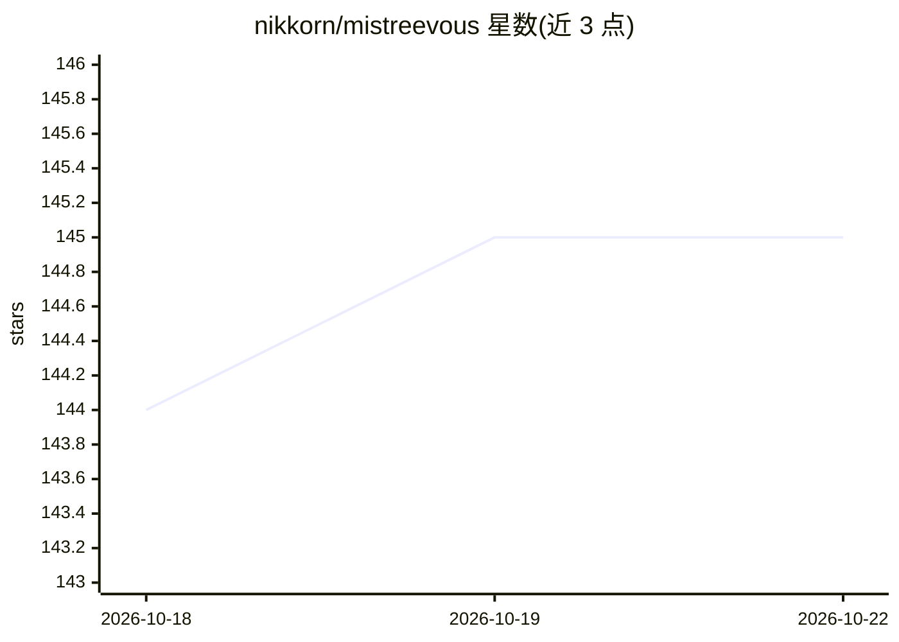

# nikkorn/mistreevous

⭐ 145 · TypeScript · MIT · 推送 2026-10-11 · [GitHub](https://github.com/nikkorn/mistreevous) · 个人维护

**JavaScript/TypeScript 行为树构建与执行库，面向游戏 AI 开发者**

TypeScript 编写的行为树库，可在 Node 与浏览器中运行。支持用 JSON 或自有 MDSL 语法定义行为树，内置组合节点（sequence/selector/parallel/race/all/lotto）、装饰节点（root/repeat/retry）与叶子节点，支持异步 action、生命周期回调、guards 中断、可种子化的随机行为以及运行时调试（getTreeNodeDetails、onNodeStateChange）。面向游戏、仿真与交互式 agent 的开发者，通过 npm 安装，另提供浏览器内编辑器与可视化工具。

## 筛选速览

| 维度 | 判定 | 备注 |
|---|---|---|
| AI 角色 | `ai-ecosystem` | LLM/agent 周边工具 |
| 许可风险 | `permissive` | MIT |
| 部署形态 | `library` | 以包/库形式分发 |
| 模型依赖 | — | README 未给出锁定关系 |
| 硬件要求 | — | 无带数字的原话,不猜 |
| 安装摩擦 | `low` | 无编译、无系统依赖或容器化 |
| 成熟度 | — | 结构信号不足 |

## 能力要点

- JSON 或 MDSL 语法定义行为树
- 内置组合/装饰/叶子节点类型与异步 action
- 可种子化 RNG 实现确定性随机行为（lotto/wait/repeat/retry）
- 同时支持 Node 与浏览器（esbuild 构建）

## 适用场景

- 为游戏 NPC 或交互式 agent 编写模块化决策逻辑
- 在仿真中通过行为树组织长-running 异步任务
- 调试运行中的行为树实例状态

## 场景标签

`Agent 框架` · 领域:Agent 开发

## 证据(README 行号)

> L5: **Mistreevous** is a lightweight, TypeScript-based behaviour tree library for Node and the browser. Define complex A
> L22: Behaviour trees are hierarchical structures designed to model decision-making processes and are used to create comp

## 星数曲线

2026-10-18 144 → 2026-10-22 145（+1）

---
*卡片 v1 · prompt 1.4 · 生成 2026-10-22 · 置信度 high · 依据 README sha `43cdaafe55c0` · [字段定义](../../DATASET.md)*
