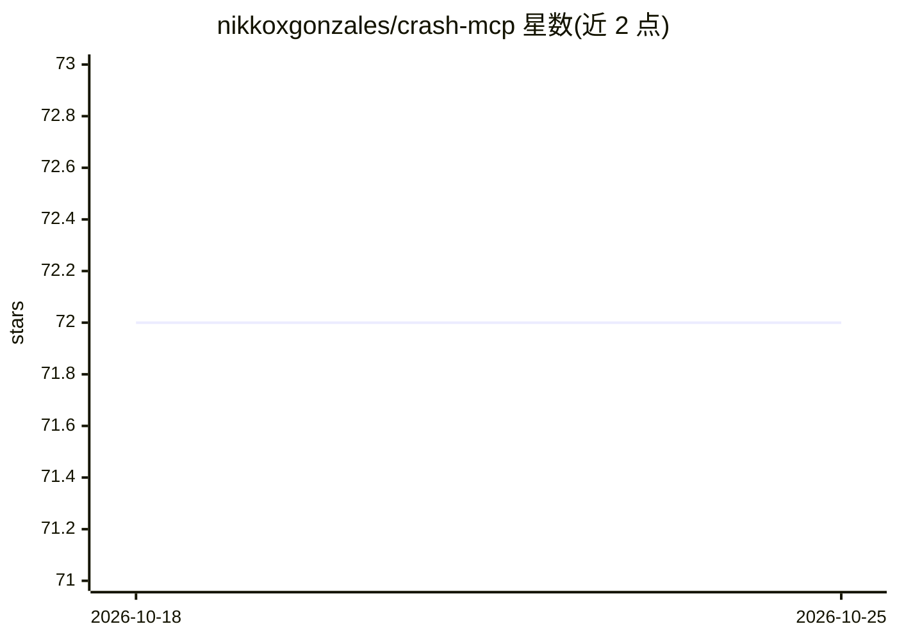

# nikkoxgonzales/crash-mcp

⭐ 72 · TypeScript · MIT · 推送 2025-12-17 · [GitHub](https://github.com/nikkoxgonzales/crash-mcp) · [官网](https://www.npmjs.com/package/crash-mcp) · 个人维护

**MCP 服务器：为 AI 助手提供结构化分步推理与校验**

CRASH 是一个 Model Context Protocol 服务器，让 AI 助手将复杂问题拆解为可追踪的推理步骤：每步包含目的、思考、结果与下一步行动，支持 0-1 置信度跟踪、步骤修订、分支探索多解路径、依赖校验与会话管理。受 MCP Sequential Thinking Server 启发，自称 token 更省。以 npm 包发布，可经 npx/bunx/deno 或 Docker 运行，接入 Claude Code、Cursor、VS Code 等 MCP 客户端。适合多步问题求解与系统化调试场景。

## 筛选速览

| 维度 | 判定 | 备注 |
|---|---|---|
| AI 角色 | `ai-ecosystem` | LLM/agent 周边工具 |
| 许可风险 | `permissive` | MIT |
| 部署形态 | `self-host` | docker 或自建部署 |
| 模型依赖 | — | README 未给出锁定关系 |
| 硬件要求 | — | 无带数字的原话,不猜 |
| 安装摩擦 | `low` | 无编译、无系统依赖或容器化 |
| 成熟度 | — | 结构信号不足 |

## 能力要点

- 结构化推理步骤，含置信度跟踪与低置信度警告
- 修订机制与分支探索多解路径（含深度限制）
- 依赖校验与会话管理（自动超时清理）
- 输出格式可选 console/JSON/Markdown

## 适用场景

- 让编码 agent 系统化分析复杂问题或调试
- 在多条解决路径间分支探索并比较
- 追踪推理步骤的置信度与修订历史

## 场景标签

 · 领域:LLM 工具/推理基础设施

## 证据(README 行号)

> L6: An MCP (Model Context Protocol) server for structured, iterative reasoning. CRASH helps AI assistants break down com
> L39: npm install crash-mcp

## 星数曲线

2026-10-18 72 → 2026-10-25 72（+0）

---
*卡片 v1 · prompt 1.4 · 生成 2026-10-24 · 置信度 high · 依据 README sha `6e299cbbe436` · [字段定义](../../DATASET.md)*
