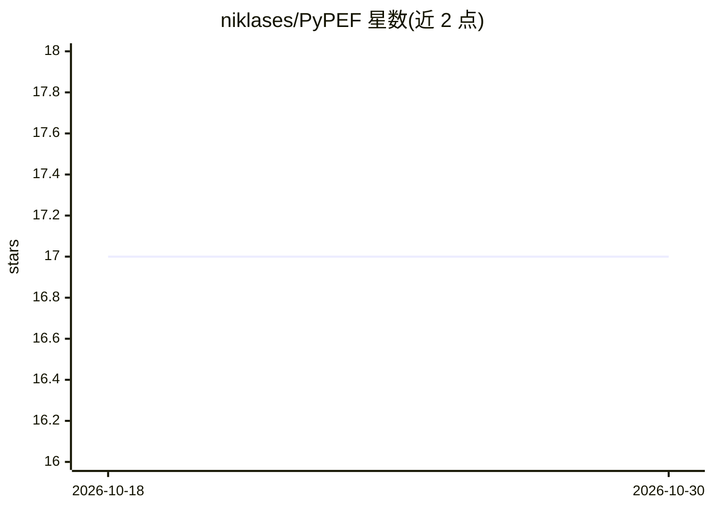

# niklases/PyPEF

⭐ 17 · Python · NOASSERTION · 推送 2026-10-29 · [GitHub](https://github.com/niklases/PyPEF) · 个人维护

**面向蛋白质工程的序列机器学习框架，从序列预测蛋白适应度**

Python 3 编写的序列级机器学习辅助蛋白质工程框架：输入野生型 FASTA 序列与变异-适应度 CSV 数据，训练回归模型（PLS/Ridge/SVR/MLP 等）预测变异体适应度，并支持系统枚举或 in silico 定向进化生成候选变异。编码方式含 one-hot、AAindex 描述符、DCA（共进化）及 ESM/ProSST 蛋白语言模型嵌入；hybrid 模式将 DCA 与 PLM 少样本微调后以差分进化优化权重集成，可选 LoRA 微调或高斯过程嵌入优化。提供 CLI、简易 GUI、Docker 镜像与 Jupyter 教程。PLM 微调需 GPU 或较长 CPU 时间。

## 筛选速览

| 维度 | 判定 | 备注 |
|---|---|---|
| AI 角色 | `ai-native` | 本体是模型或模型工具 |
| 许可风险 | `none` | NOASSERTION |
| 部署形态 | `desktop` | 安装包/桌面程序 |
| 模型依赖 | — | README 未给出锁定关系 |
| 硬件要求 | — | 无带数字的原话,不猜 |
| 安装摩擦 | `low` | 无编译、无系统依赖或容器化 |
| 成熟度 | — | 结构信号不足 |

## 能力要点

- 多种序列编码（one-hot/AAindex/DCA）与 ESM、ProSST 蛋白语言模型嵌入
- hybrid 模式：DCA+PLM 少样本微调集成，权重经差分进化优化
- LoRA 微调与高斯过程嵌入优化两种监督调优策略
- in silico 定向进化（Metropolis-Hastings）与变异组合预测集系统生成

## 适用场景

- 预测蛋白质变异体的适应度以筛选工程候选
- 对已知替换位点做双重/三重/四重重组合并批量预测
- 通过定向进化算法搜索高适应度变异序列

## 场景标签

`教程课程` · 领域:学习与行业

## 证据(README 行号)

> L9: a framework written in Python 3 for performing sequence-based machine learning-assisted protein engineering to predi
> L123: Training and testing a model (encoding technique = {`aaidx`, `onehot`, `dca`}, regression model = {`pls`, `ridge`,
> L202: pypef hybrid -l LEARNING_SET.fasl -t TEST_SET.fasl --params GREMLIN --plm esm

## 星数曲线

2026-10-18 17 → 2026-10-30 17（+0）

---
*卡片 v1 · prompt 1.4 · 生成 2026-10-29 · 置信度 high · 依据 README sha `acad548da02f` · [字段定义](../../DATASET.md)*
