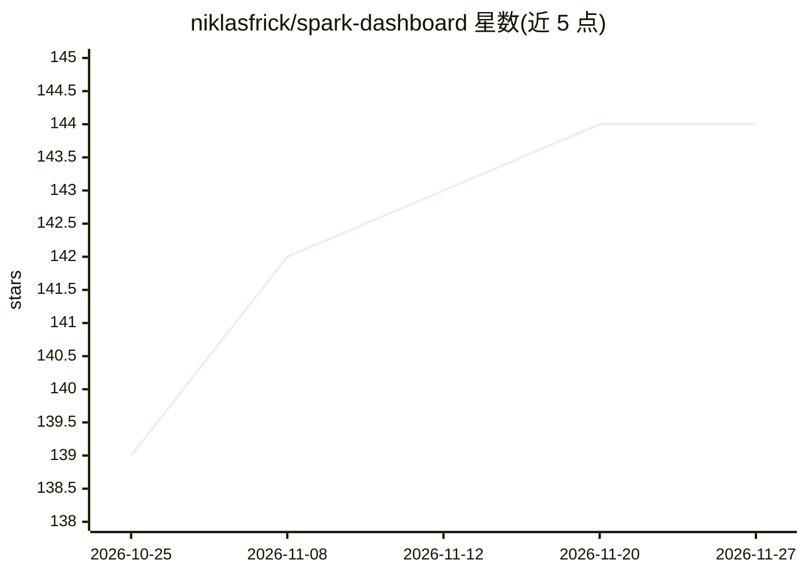

# niklasfrick/spark-dashboard

⭐ 144 · TypeScript · MIT · 推送 2026-11-23 · [GitHub](https://github.com/niklasfrick/spark-dashboard) · 个人维护

**面向 Linux/NVIDIA 主机的 GPU 与 LLM 推理实时监控面板**

Rust 后端通过 NVML、sysinfo、procfs 以 1 秒轮询采集 GPU、CPU、内存、磁盘与网络指标，同时经 Prometheus 端点读取 vLLM、SGLang、llama.cpp 引擎统计（Ollama 仅显示状态与已加载模型），经 WebSocket 推送到 React 前端。面板可自由拖拽编排、按页面保存于服务端，支持多引擎并列监控、墙面显示屏轮播与 15 分钟滚动历史。安装路径为 cargo、Docker 镜像或源码脚本，以 systemd 服务运行。

## 筛选速览

| 维度 | 判定 | 备注 |
|---|---|---|
| AI 角色 | `ai-ecosystem` | LLM/agent 周边工具 |
| 许可风险 | `permissive` | MIT |
| 部署形态 | `self-host` | docker 或自建部署 |
| 模型依赖 | local-ok | 支持本地模型 |
| 硬件要求 | — | 无带数字的原话,不猜 |
| 安装摩擦 | `low` | 无编译、无系统依赖或容器化 |
| 成熟度 | — | 结构信号不足 |

## 能力要点

- 硬件指标（GPU 利用率/温度/功耗/降频事件、CPU 热力图、内存/磁盘/网络）1 秒轮询
- vLLM/SGLang/llama.cpp 推理指标：tokens/s、首 token 延迟、KV 缓存、SLO Goodput
- 通过进程扫描与 Docker API 自动发现引擎，支持多引擎并行与面板绑定固定引擎
- 面板自由编排、命名页面独立 URL、服务端持久化、墙面显示轮播

## 适用场景

- 监控运行 vLLM/llama.cpp 推理服务的 GPU 服务器负载与吞吐
- 在墙面大屏展示推理集群各引擎的实时指标
- 排查 GPU 降频、功耗制动等硬件事件
- 同时对比多个推理引擎的延迟与缓存表现

## 场景标签

`LLM 可观测性` · 领域:评测与运维

## 证据(README 行号)

> L3: Real-time hardware and LLM inference monitoring for Linux systems with NVIDIA
> L6: A Rust backend collects GPU, CPU, memory, disk, and network metrics alongside
> L83: **LLM Engine Monitoring** (vLLM, SGLang and llama.cpp via Prometheus metrics)

## 星数曲线

2026-10-25 139 → 2026-11-27 144（+5）

---
*卡片 v1 · prompt 1.4 · 生成 2026-11-27 · 置信度 high · 依据 README sha `12091315c518` · [字段定义](../../DATASET.md)*
