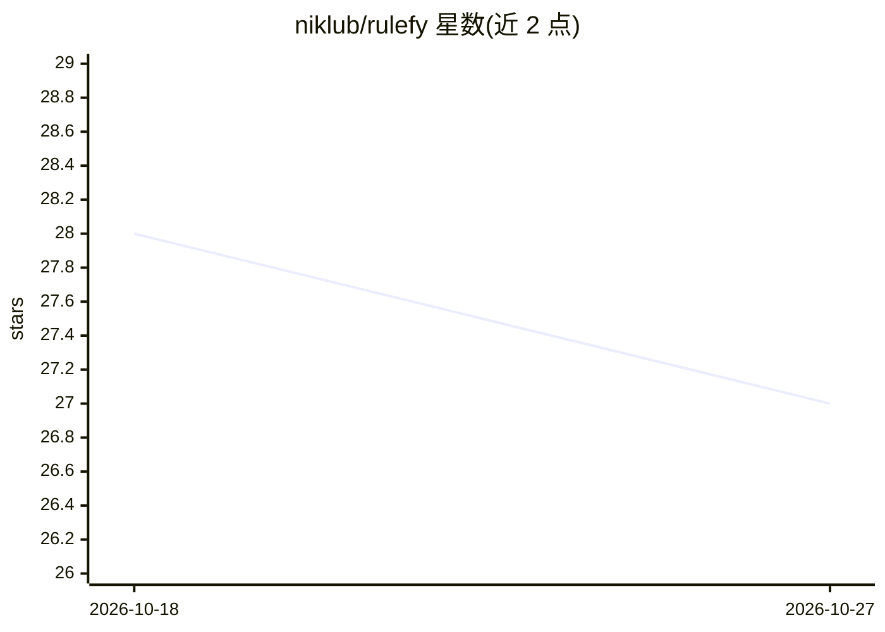

# niklub/rulefy

⭐ 27 · TypeScript · MIT · 推送 2026-05-05 · [GitHub](https://github.com/niklub/rulefy) · 个人维护

**从代码仓库生成 Cursor AI 规则文件的 CLI 工具**

Node.js 命令行工具，读取 GitHub 仓库或本地代码库，提取项目结构、约定与模式，调用 Claude AI（需 ANTHROPIC_API_KEY，默认 claude-sonnet-4-5）生成为 Cursor 编辑器定制的 .rules.mdc 规则文件，用户需在 Cursor 设置中手动导入并重启生效。支持分块处理超出 LLM token 上限的大型代码库，并继承 repomix 的文件筛选（--include/--exclude/--compress）与 --chunk-size 等选项以控制上下文长度、成本与速率限制。通过 npm 全局安装或 npx 直接运行，要求 Node.js 18+。

## 筛选速览

| 维度 | 判定 | 备注 |
|---|---|---|
| AI 角色 | `ai-ecosystem` | LLM/agent 周边工具 |
| 许可风险 | `permissive` | MIT |
| 部署形态 | `library` | 以包/库形式分发 |
| 模型依赖 | locked-api |  |
| 硬件要求 | — | 无带数字的原话,不猜 |
| 安装摩擦 | `low` | 无编译、无系统依赖或容器化 |
| 成熟度 | — | 结构信号不足 |

## 能力要点

- 分析仓库并生成为 Cursor 定制的 .rules.mdc 规则文件
- 分块处理超出 LLM token 限制的大型代码库
- 支持 repomix 的文件筛选与压缩选项（--include/--exclude/--compress/--chunk-size）
- npm 全局安装或 npx 免安装运行

## 适用场景

- 为自己的仓库生成 Cursor AI 编码规则以获得匹配项目风格的建议
- 在大型代码库上生成规则且控制上下文长度与 API 成本
- 为团队统一 Cursor 项目约定配置

## 场景标签

`提示工程` `代码生成` · 领域:Agent 开发

## 证据(README 行号)

> L21: - 🤖 Generate tailored Cursor rules using Claude AI
> L63: 2. Based on the content, generate rules for Cursor AI

## 星数曲线

2026-10-18 28 → 2026-10-27 27（-1）

---
*卡片 v1 · prompt 1.4 · 生成 2026-10-26 · 置信度 high · 依据 README sha `34d0b5273070` · [字段定义](../../DATASET.md)*
