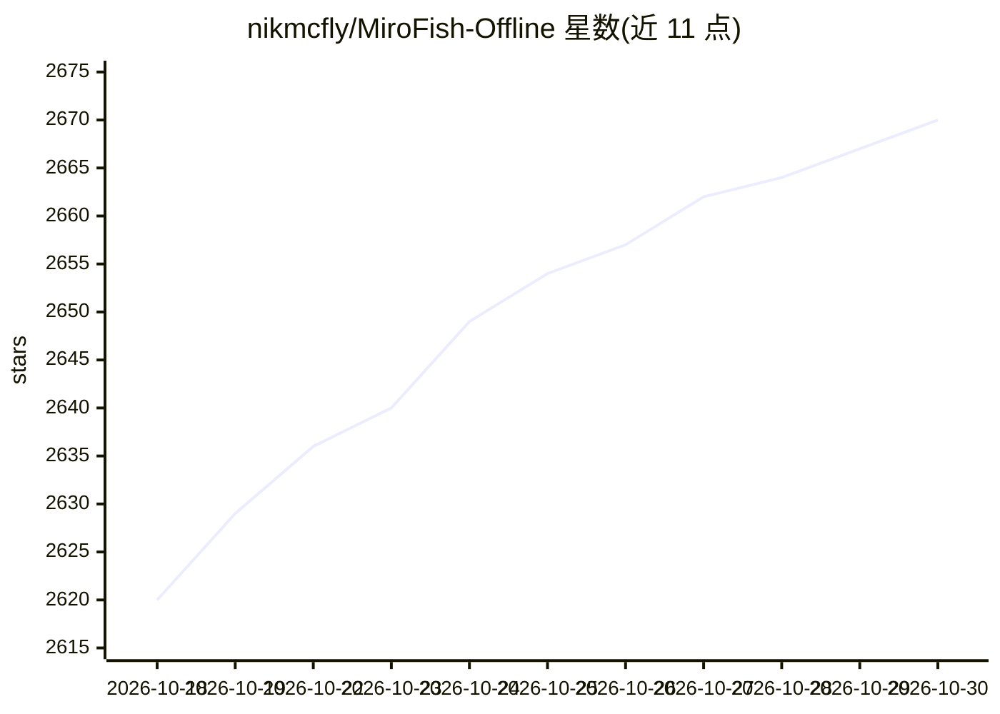

# nikmcfly/MiroFish-Offline

⭐ 2,670 · Python · AGPL-3.0 · 推送 2026-03-24 · [GitHub](https://github.com/nikmcfly/MiroFish-Offline) · [官网](https://x.com/nikmcfly69/status/2033147482331390328) · 个人维护 · 中文 README

**本地多智能体社会模拟引擎：用 AI agent 仿真舆论与市场反应**

MiroFish 的全本地化英文分支：上传文档后抽取实体与关系构建 Neo4j 知识图谱，生成数百个带独立人格与记忆的 agent，在模拟社交平台上发帖、争论并演化观点，最终由 ReportAgent 产出结构化分析报告，也可与任意 agent 对话。原版的 Zep Cloud 换为 Neo4j CE 5.15，DashScope/OpenAI API 换为 Ollama（qwen2.5、nomic-embed-text），零云依赖；支持 Docker Compose 或 Python+Node 手动部署，GPU 有 VRAM 要求，可 CPU 运行但更慢。

## 筛选速览

| 维度 | 判定 | 备注 |
|---|---|---|
| AI 角色 | `ai-native` | 本体是模型或模型工具 |
| 许可风险 | `viral` | AGPL-3.0 |
| 部署形态 | `self-host` | docker 或自建部署 |
| 模型依赖 | local-ok | 支持本地模型 |
| 硬件要求 | `gpu-8g` | |
| 安装摩擦 | `low` | 无编译、无系统依赖或容器化 |
| 成熟度 | — | 结构信号不足 |

## 能力要点

- 文档→知识图谱→数百 agent 人格→社交模拟→报告的完整流程
- 本地栈：Neo4j 5.15 + Ollama（qwen2.5 / nomic-embed-text），零云依赖
- 混合检索（0.7 向量相似度 + 0.3 BM25）与 GraphStorage 抽象层
- 可与任意模拟 agent 对话，记忆与人格持久保存

## 适用场景

- 发布前模拟公众对新闻稿或声明的反应
- 输入财经新闻观察模拟市场情绪变化
- 测试草案政策在模拟公众中的影响
- 文档驱动的创意叙事实验

## 场景标签

`多智能体` `知识图谱` · 领域:Agent 开发

## 证据(README 行号)

> L16: MiroFish is a multi-agent simulation engine: upload any document (press release, policy draft, financial report), a
> L32: 3. **Simulation** — Agents interact on simulated social platforms: posting, replying, arguing, shifting opinions. T

## 星数曲线

2026-10-18 2,620 → 2026-10-30 2,670（+50）

---
*卡片 v1 · prompt 1.4 · 生成 2026-10-21 · 置信度 high · 依据 README sha `5974b1b635df` · [字段定义](../../DATASET.md)*
