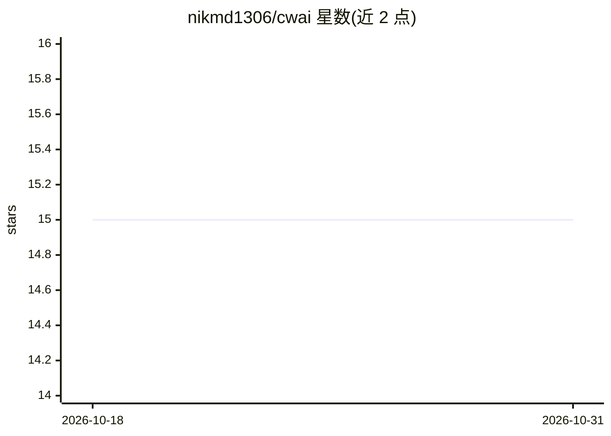

# nikmd1306/cwai

⭐ 15 · Go · MIT · 推送 2026-07-18 · [GitHub](https://github.com/nikmd1306/cwai) · [官网](https://pkg.go.dev/github.com/nikmd1306/cwai) · 个人维护

**从 git 暂存改动生成 Conventional Commits 提交信息的 CLI 工具**

Go 编写的命令行工具：读取 git 暂存区 diff，发送给任意 OpenAI 兼容 API 的模型，生成 Conventional Commits 格式的提交信息，用户可接受、编辑或重新生成。支持两种模式：交互式独立运行或静默安装为 prepare-commit-msg 钩子；具备结构化输出与按 token 上限截断 diff 的机制。面向开发者，需要 API key 或本地模型（Ollama/LM Studio），提供安装脚本、go install、二进制与源码构建等安装途径。

## 筛选速览

| 维度 | 判定 | 备注 |
|---|---|---|
| AI 角色 | `ai-native` | 本体是模型或模型工具 |
| 许可风险 | `permissive` | MIT |
| 部署形态 | `desktop` | 安装包/桌面程序 |
| 模型依赖 | local-ok | 支持本地模型 |
| 硬件要求 | — | 无带数字的原话,不猜 |
| 安装摩擦 | `medium` | 含编译或系统依赖之一 |
| 成熟度 | — | 结构信号不足 |

## 能力要点

- 从 git diff 生成 Conventional Commits 提交信息
- 兼容任意 OpenAI 兼容 API，可接 Ollama/LM Studio 本地模型
- 支持交互独立模式与 prepare-commit-msg 钩子模式
- diff 截断以适配模型 token 限制，支持结构化输出

## 适用场景

- 写提交信息时让 AI 根据暂存改动自动生成规范格式
- 通过 git 钩子在每次提交前自动生成信息
- 在 CI/脚本中用 -y 自动接受生成的提交信息

## 场景标签

`代码生成` · 领域:编码与开发

## 证据(README 行号)

> L13: cwai is a command-line tool that writes git commit messages for you. It looks at your staged changes (`git add`), s
> L18: - Works with any OpenAI-compatible API (OpenAI, Anthropic, local models)

## 星数曲线

2026-10-18 15 → 2026-10-31 15（+0）

---
*卡片 v1 · prompt 1.4 · 生成 2026-10-30 · 置信度 high · 依据 README sha `589931abea76` · [字段定义](../../DATASET.md)*
