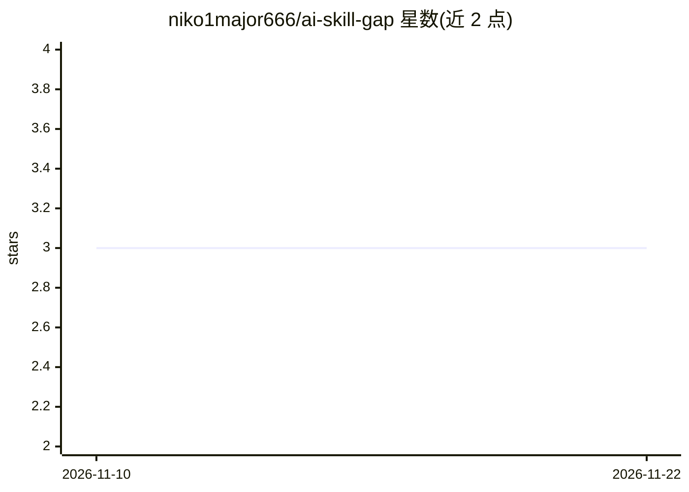

# niko1major666/ai-skill-gap

⭐ 3 · Python · MIT · 推送 2026-11-12 · [GitHub](https://github.com/niko1major666/ai-skill-gap) · [官网](https://hdwqwu3howppf2z2xv9i2q.streamlit.app/) · 个人维护 · 中文 README

**面向转行求职者的 AI 岗位技能差距分析与学习路径工具**

基于 4240 条公开 AI 岗位 JD、79 家公司、168 项技能的知识库，上传简历后经结构化解析、技能实体抽取与 JD 语义匹配，输出匹配度打分、must/nice 缺口清单、P0/P1/P2 优先级学习路径与反向岗位推荐。技术栈为 Python 3.12 + Streamlit 三页面，抽取用 SiamesuUIE/BERT-NER，匹配用 TF-IDF 与 BGE 嵌入；DeepSeek 增强默认关闭、外发前 PII 脱敏；免注册，提供在线版、本地脚本与 Docker 部署。

## 筛选速览

| 维度 | 判定 | 备注 |
|---|---|---|
| AI 角色 | `ai-native` | 本体是模型或模型工具 |
| 许可风险 | `permissive` | MIT |
| 部署形态 | `desktop` | 安装包/桌面程序 |
| 模型依赖 | locked-api |  |
| 硬件要求 | — | 无带数字的原话,不猜 |
| 安装摩擦 | `low` | 无编译、无系统依赖或容器化 |
| 成熟度 | — | 结构信号不足 |

## 能力要点

- 从 16 个公开招聘源采集 4240 条 JD，抽取 168 项技能并按 must/nice 三级判定
- 简历→技能→JD 语义匹配打分，输出差距报告与三阶段学习路径（无 API key 也可用规则版）
- 多岗位对比、反向岗位推荐、技能画像、公司×技能矩阵
- 隐私机制：上传前确认、AI 增强默认关闭、外发前 6 类 PII 强制脱敏

## 适用场景

- 转行前想知道目标 AI 岗位的硬性要求和自己的缺口
- 根据缺口清单生成先修顺序和学习计划
- 对比多个目标岗位的匹配度决定投递方向

## 场景标签

`推荐系统` · 领域:学习与行业

## 证据(README 行号)

> L27: |你的简历（PDF / Word / 粘贴文本）|结构化解析 → 技能实体抽取 → 与 JD 技能语义匹配|匹配度打分、must/nice 缺口、P0/P1/P2 优先级、学习资源、可导出报告|
> L73: 4. 输出匹配度打分 + 逐项对比 + 差距报告（缺失技能/优先级/学习资源）；AI 解读会结合简历解析出的专业给出迁移建议（未识别到专业则不展示）
> L90: |匹配 B|BGE-base-zh-v1.5（768 维）|语义匹配，第 4 周接入|

## 星数曲线

2026-11-10 3 → 2026-11-22 3（+0）

---
*卡片 v1 · prompt 1.4 · 生成 2026-11-21 · 置信度 high · 依据 README sha `d183adae9bba` · [字段定义](../../DATASET.md)*
