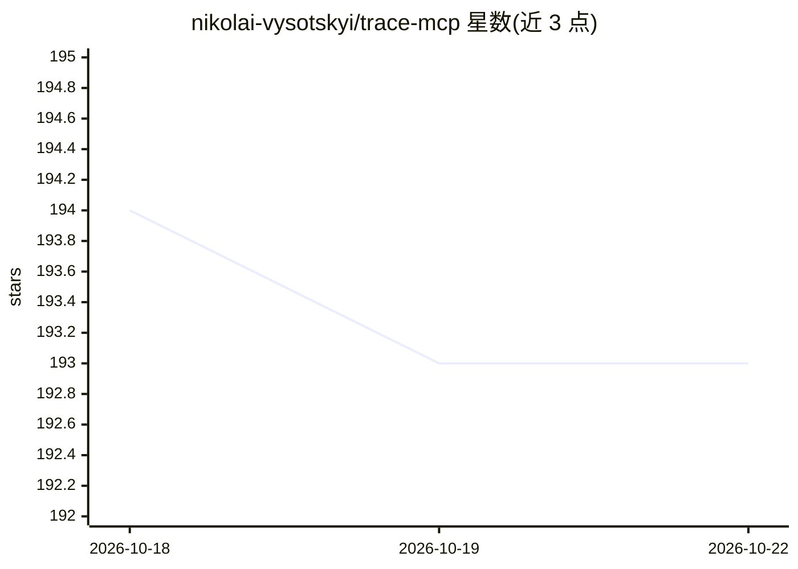

# nikolai-vysotskyi/trace-mcp

⭐ 193 · TypeScript · MIT · 推送 2026-10-21 · [GitHub](https://github.com/nikolai-vysotskyi/trace-mcp) · [官网](https://trace-mcp.com) · 个人维护

**为 AI 编码 agent 提供代码库依赖图索引的 MCP 服务器**

trace-mcp 对代码库一次性构建跨语言、框架感知的依赖图，通过 MCP 协议向编码 agent 提供预计算的结构查询（变更影响、请求流、测试覆盖、决策记录等 182 个工具），声称评审单个 PR 的输入 token 从 13,595 降至 3,291（60 个合并 PR 中位数）。同一引擎可索引 Obsidian/Logseq/Markdown 笔记库为图。代码留在本地。提供 npm 安装的 CLI/MCP 服务器与可选 Electron 桌面应用（macOS .dmg、Windows .exe），桌面端含 GPU 图可视化与一键接入多种 MCP 客户端。

## 筛选速览

| 维度 | 判定 | 备注 |
|---|---|---|
| AI 角色 | `ai-ecosystem` | LLM/agent 周边工具 |
| 许可风险 | `permissive` | MIT |
| 部署形态 | `desktop` | 安装包/桌面程序 |
| 模型依赖 | — | README 未给出锁定关系 |
| 硬件要求 | — | 无带数字的原话,不猜 |
| 安装摩擦 | `low` | 无编译、无系统依赖或容器化 |
| 成熟度 | — | 结构信号不足 |

## 能力要点

- 跨语言依赖图 + 88 个框架集成、81 种语言、182 个工具
- 通过 MCP 服务预计算结构，减少 agent 重复读文件（自称 72.7% token 减少）
- 同一引擎索引 Markdown 知识库（wikilink/标签/嵌入转为图边）
- 可选 Electron 桌面应用：GPU 图浏览器 + 一键接入 MCP 客户端

## 适用场景

- 让 Claude Code/Cursor 等 agent 用一次工具调用回答变更影响分析
- 大型代码库中降低编码 agent 的 token 消耗与延迟
- 把代码依赖与 Obsidian 笔记知识库放进同一图做关联查询

## 场景标签

 · 领域:开发者工具/代码智能

## 证据(README 行号)

> L81: trace-mcp builds a **cross-language dependency graph** from your source code and exposes it through the Model Conte
> L115: The app talks to the same `trace-mcp` daemon (`http://127.0.0.1:3741`) that MCP clients use, so anything you index

## 星数曲线

2026-10-18 194 → 2026-10-22 193（-1）

---
*卡片 v1 · prompt 1.4 · 生成 2026-10-22 · 置信度 mid · 依据 README sha `5ab7c1c4f76f` · [字段定义](../../DATASET.md)*
