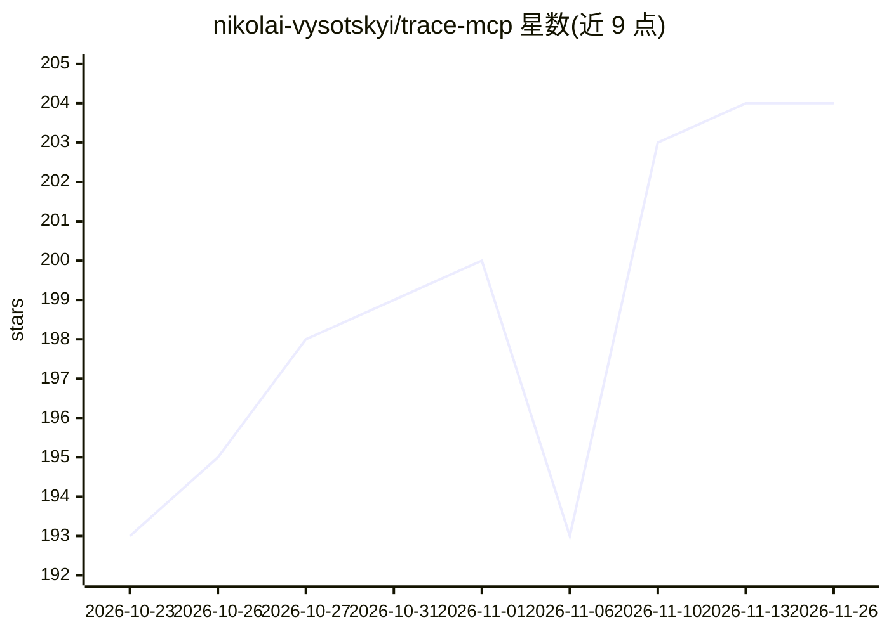

# nikolai-vysotskyi/trace-mcp

⭐ 204 · TypeScript · MIT · 推送 2026-11-25 · [GitHub](https://github.com/nikolai-vysotskyi/trace-mcp) · [官网](https://trace-mcp.com) · 个人维护

**给 AI 编码代理的代码索引 MCP 服务器，减少上下文 token 消耗**

MCP 服务器形态的代码智能工具：对代码库一次性构建跨语言依赖图并增量更新，通过 MCP 暴露 182 个工具供 Claude Code、Cursor 等代理查询，替代反复读文件的上下文消耗。支持 81 种语言、91 个框架集成，提供变更影响分析、决策记录检索、跨会话记忆与 Markdown 知识库（Obsidian/Logseq）同图索引；另附可选 Electron 桌面应用，含 GPU 图谱浏览器与 MCP 客户端一键接入。代码保持在本地运行，MIT 许可。

## 筛选速览

| 维度 | 判定 | 备注 |
|---|---|---|
| AI 角色 | `ai-ecosystem` | LLM/agent 周边工具 |
| 许可风险 | `permissive` | MIT |
| 部署形态 | `desktop` | 安装包/桌面程序 |
| 模型依赖 | — | README 未给出锁定关系 |
| 硬件要求 | — | 无带数字的原话,不猜 |
| 安装摩擦 | `low` | 无编译、无系统依赖或容器化 |
| 成熟度 | — | 结构信号不足 |

## 能力要点

- 构建框架感知的跨语言依赖图，经 MCP 提供 182 个工具
- 官方基准：60 个 PR 中位输入 token 从 13,595 降至 3,291
- 决策知识图谱与代码符号关联，支持跨会话恢复上下文
- 可选 Electron 桌面应用，GPU 图谱浏览器与多客户端一键接线

## 适用场景

- 让编码代理审查 PR 时减少重复读文件和 token 开销
- 查询修改某个模型/符号会影响哪些文件与服务
- 把 Obsidian/Logseq 笔记与代码放进同一个图谱查询
- 在桌面端可视化浏览大型代码库的依赖结构

## 场景标签

`编码 Agent` `知识图谱` `知识库管理` · 领域:编码与开发

## 证据(README 行号)

> L17: npm install -g trace-mcp   # MCP server, no app
> L81: trace-mcp builds a **cross-language dependency graph** from your source code and exposes it through the Model Conte

## 星数曲线

2026-10-23 193 → 2026-11-26 204（+11）

---
*卡片 v1 · prompt 1.4 · 生成 2026-11-25 · 置信度 mid · 依据 README sha `d9fae508287f` · [字段定义](../../DATASET.md)*
