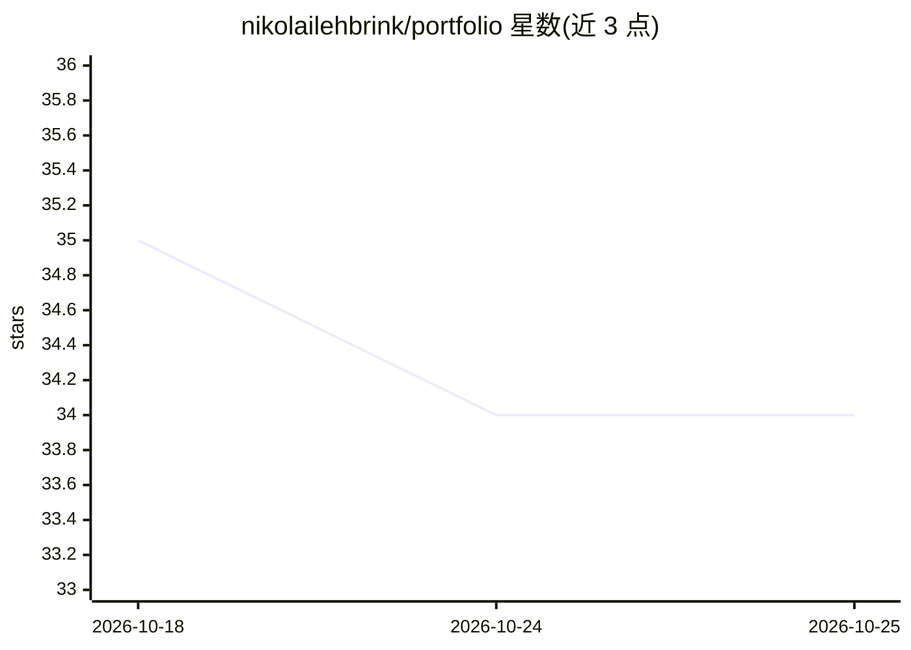

# nikolailehbrink/portfolio

⭐ 34 · MDX · GPL-3.0 · 推送 2026-10-15 · [GitHub](https://github.com/nikolailehbrink/portfolio) · [官网](https://www.nikolailehbr.ink) · 个人维护

**个人作品集网站：展示项目与博客，含定制 AI 聊天机器人**

开发者个人作品集网站的源码，使用 Astro、TypeScript、MDX 与 Tailwind CSS 构建，包含主页（项目列表、技能、工作经历、联系方式）、MDX 驱动的博客、SEO 与无障碍优化。其中 AI 部分：一个基于 LlamaIndex.TS 与 Vercel AI SDK 开发、由 OpenAI API 驱动的个人聊天机器人，可回答与站长相关的领域信息。README 未给出安装或运行命令，仅欢迎通过 issue 与 PR 参与改进。

## 筛选速览

| 维度 | 判定 | 备注 |
|---|---|---|
| AI 角色 | `ai-enhanced` | 去掉 AI 部分产品仍成立 |
| 许可风险 | `viral` | GPL-3.0 |
| 部署形态 | `None` |  |
| 模型依赖 | — | README 未给出锁定关系 |
| 硬件要求 | — | 无带数字的原话,不猜 |
| 安装摩擦 | `low` | 无编译、无系统依赖或容器化 |
| 成熟度 | — | 结构信号不足 |

## 能力要点

- Astro + TypeScript + MDX + Tailwind CSS 技术栈构建
- 基于 LlamaIndex.TS / Vercel AI SDK / OpenAI API 的个人聊天机器人
- MDX 驱动的博客内容管理
- 基于 Radix UI 与 shadcn/ui 的无障碍设计

## 适用场景

- 搭建含 AI 聊天机器人的个人作品集网站
- 参考 Astro + Vercel AI SDK + OpenAI 的聊天机器人集成方式

## 场景标签

`聊天机器人` · 领域:对话与助手

## 证据(README 行号)

> L3: Source code for my personal portfolio website. The site showcases my projects and gives an insight into my backgroun
> L13: - **Custom AI Chatbot**: A personal AI chatbot capable of responding to queries about domain-specific information r

## 星数曲线

2026-10-18 35 → 2026-10-25 34（-1）

---
*卡片 v1 · prompt 1.4 · 生成 2026-10-25 · 置信度 high · 依据 README sha `f6f0c8a32c99` · [字段定义](../../DATASET.md)*
