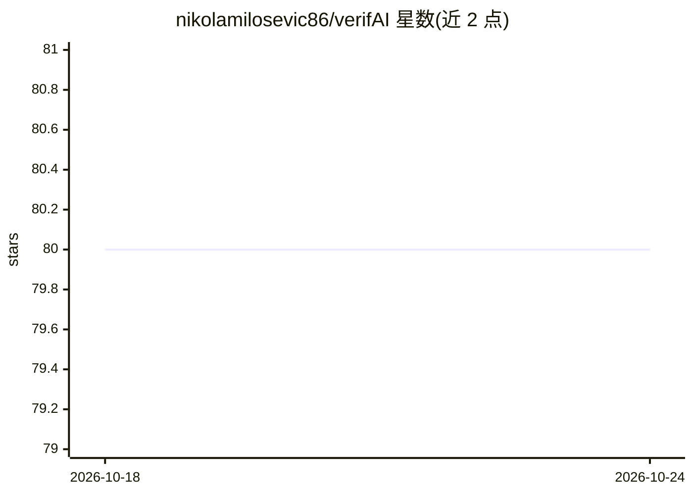

# nikolamilosevic86/verifAI

⭐ 80 · Jupyter Notebook · AGPL-3.0 · 推送 2026-09-01 · [GitHub](https://github.com/nikolamilosevic86/verifAI) · [官网](https://verifai-project.com) · 组织维护

**可验证答案的生成式文档问答引擎：检索、生成并核验引用**

面向终端用户的生成式搜索/问答系统：对本地文档（PDF/EPUB/PPTX/DOCX/MD/TXT）建立词法+语义混合检索索引，用 LLM 生成带引用的回答，再由专门微调的验证模型（基于 DeBERTa、在 SciFact 上微调）核验生成文本是否与来源一致并标记幻觉。支持任何符合 OpenAI API 标准的 LLM（可经 vLLM/Nvidia NIM/Ollama 或商业 API 部署），提供 React 前端、用户注册与 AzureAD 单点登录；另有生物医学版本（Medline 数据）。由拜耳与塞尔维亚人工智能研究与发展研究所维护，AGPL 许可，需签署贡献者协议。

## 筛选速览

| 维度 | 判定 | 备注 |
|---|---|---|
| AI 角色 | `ai-native` | 本体是模型或模型工具 |
| 许可风险 | `viral` | AGPL-3.0 |
| 部署形态 | `library` | 以包/库形式分发 |
| 模型依赖 | local-ok | 支持本地模型 |
| 硬件要求 | — | 无带数字的原话,不猜 |
| 安装摩擦 | `low` | 无编译、无系统依赖或容器化 |
| 成熟度 | — | 结构信号不足 |

## 能力要点

- 词法+语义混合检索，支持 HuggingFace 任意嵌入模型
- 基于 NLI 微调模型的回答幻觉验证与最近原文句定位
- 已测试 200GB+ 数据、3000 万文档规模的索引
- 发布两个 Mistral 7B QLoRA 微调模型与 PQAref 数据集

## 适用场景

- 在本地文档库上获得带引用且经过幻觉核验的问答
- 生物医学文献（Medline）问答与引用核查
- 需要可审计答案来源的企业/科研检索场景

## 场景标签

`文档问答` · 领域:知识与检索

## 证据(README 行号)

> L16: VerifAI is a document-based question-answering systems that aims to address problem of hallucinations in generative
> L18: VerifAI is an AI system designed to answer users' questions by retrieving the most relevant documents, generate ans
> L41: * Verification that generated text does not contain hallucinations by a specially fine-tuned model

## 星数曲线

2026-10-18 80 → 2026-10-24 80（+0）

---
*卡片 v1 · prompt 1.4 · 生成 2026-10-24 · 置信度 high · 依据 README sha `bf415f9b58dc` · [字段定义](../../DATASET.md)*
