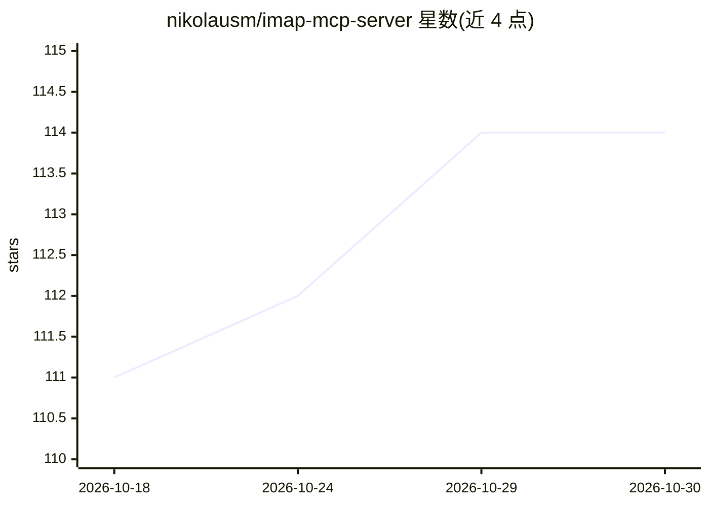

# nikolausm/imap-mcp-server

⭐ 114 · TypeScript · MIT · 推送 2026-10-26 · [GitHub](https://github.com/nikolausm/imap-mcp-server) · 个人维护

**让 AI 助手通过 MCP 收发和管理多个邮箱的 IMAP/SMTP 服务器**

TypeScript 实现的 Model Context Protocol 服务器，把 IMAP/SMTP 邮件能力以工具形式提供给 Claude Code、Claude Desktop 等 MCP 客户端：搜索、读取、移动、标记、删除邮件，通过 SMTP 发送/回复/转发，文件夹管理与多账户同时管理。账户凭据以 AES-256 加密存储于 ~/.imap-mcp/accounts.json，提供本地 Web 配置向导（含 15+ 邮箱服务商预设）。支持只读模式与工具白名单限制，可用环境变量在运行时注入凭据。需 Node.js 22.12+。

## 筛选速览

| 维度 | 判定 | 备注 |
|---|---|---|
| AI 角色 | `ai-ecosystem` | LLM/agent 周边工具 |
| 许可风险 | `permissive` | MIT |
| 部署形态 | `library` | 以包/库形式分发 |
| 模型依赖 | — | README 未给出锁定关系 |
| 硬件要求 | — | 无带数字的原话,不猜 |
| 安装摩擦 | `low` | 无编译、无系统依赖或容器化 |
| 成熟度 | — | 结构信号不足 |

## 能力要点

- 搜索/读取/移动/删除邮件与 SMTP 发送、回复、转发
- 多 IMAP 账户管理，凭据 AES-256 加密存储
- 本地 Web 配置向导，预置 Gmail/Outlook/Yahoo 等 15+ 服务商设置
- 只读模式与工具白名单环境变量限制 agent 可用工具

## 适用场景

- 在 Claude Code / Claude Desktop 中用自然语言查收和回复邮件
- 给 AI 助手只读权限审计邮箱内容（只读模式）
- 同时管理多个邮箱账户并批量清理邮件

## 场景标签

 · 领域:AI 工具集成/邮件

## 证据(README 行号)

> L5: A powerful Model Context Protocol (MCP) server that provides seamless IMAP email integration with secure account man
> L229: claude mcp add imap -- npx -y imap-mcp-server

## 星数曲线

2026-10-18 111 → 2026-10-30 114（+3）

---
*卡片 v1 · prompt 1.4 · 生成 2026-10-23 · 置信度 high · 依据 README sha `fffc26b9b7e2` · [字段定义](../../DATASET.md)*
