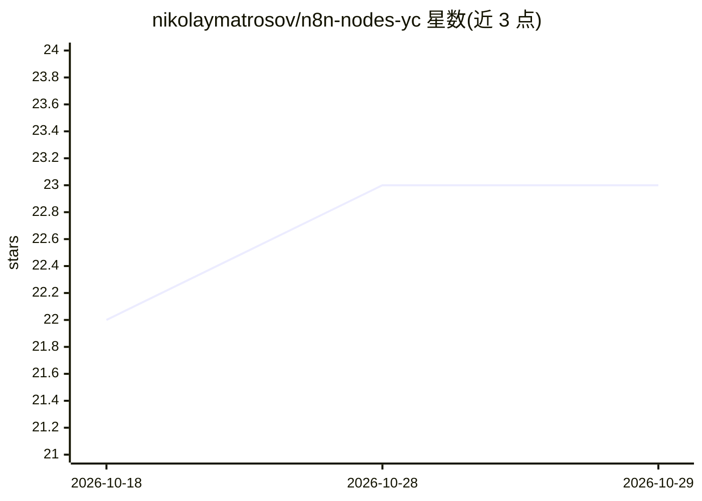

# nikolaymatrosov/n8n-nodes-yc

⭐ 23 · TypeScript · MIT · 推送 2026-04-21 · [GitHub](https://github.com/nikolaymatrosov/n8n-nodes-yc) · 个人维护

**n8n 的 Yandex Cloud 集成节点包：GPT、对象存储、Serverless 等接入工作流**

面向 n8n 工作流平台的社区节点包，将 Yandex Cloud 各服务接入 n8n：YandexGPT Chat Model 节点作为 LangChain 兼容的聊天模型组件用于 AI Chain/Agent，Foundation Models 节点经 REST API 直接调用 YandexGPT；另提供对象存储（S3 API 兼容，bucket/object 全量操作）、Serverless 函数与容器 HTTP 调用（自动 IAM token）、Compute 虚拟机启停、Data Streams 流写入与 Message Queue 消息发送等节点。认证分别使用 API key、静态密钥与服务账户 JSON。通过 n8n UI 安装，README 记录了升级异常的卸载重装 workaround。

## 筛选速览

| 维度 | 判定 | 备注 |
|---|---|---|
| AI 角色 | `ai-ecosystem` | LLM/agent 周边工具 |
| 许可风险 | `permissive` | MIT |
| 部署形态 | `None` |  |
| 模型依赖 | — | README 未给出锁定关系 |
| 硬件要求 | — | 无带数字的原话,不猜 |
| 安装摩擦 | `low` | 无编译、无系统依赖或容器化 |
| 成熟度 | — | 结构信号不足 |

## 能力要点

- LangChain 兼容的 YandexGPT Chat Model 节点（温度/超时/重试等参数，最大 8000 tokens）
- Object Storage 节点覆盖 bucket 与 object 全量操作及预签名 URL 生成
- Serverless Functions/Containers 节点自动获取 IAM token 并经 HTTP 调用
- Compute 虚拟机启停与 Data Streams/Message Queue 消息节点

## 适用场景

- 在 n8n 工作流中用 YandexGPT 构建聊天机器人、RAG 或 AI Agent
- 自动化操作 Yandex Cloud 对象存储做备份与文件管理
- 从工作流触发 Serverless 函数或容器并处理返回结果
- 向消息队列/数据流写入消息实现异步集成

## 场景标签

`工作流自动化` · 领域:效率与自动化

## 证据(README 行号)

> L14: Integration package for working with Yandex Cloud services in n8n.
> L20: **Node for integration with Yandex Cloud Foundation Models API as a language model for LangChain.** This node is an

## 星数曲线

2026-10-18 22 → 2026-10-29 23（+1）

---
*卡片 v1 · prompt 1.4 · 生成 2026-10-27 · 置信度 high · 依据 README sha `ea68ad564d77` · [字段定义](../../DATASET.md)*
