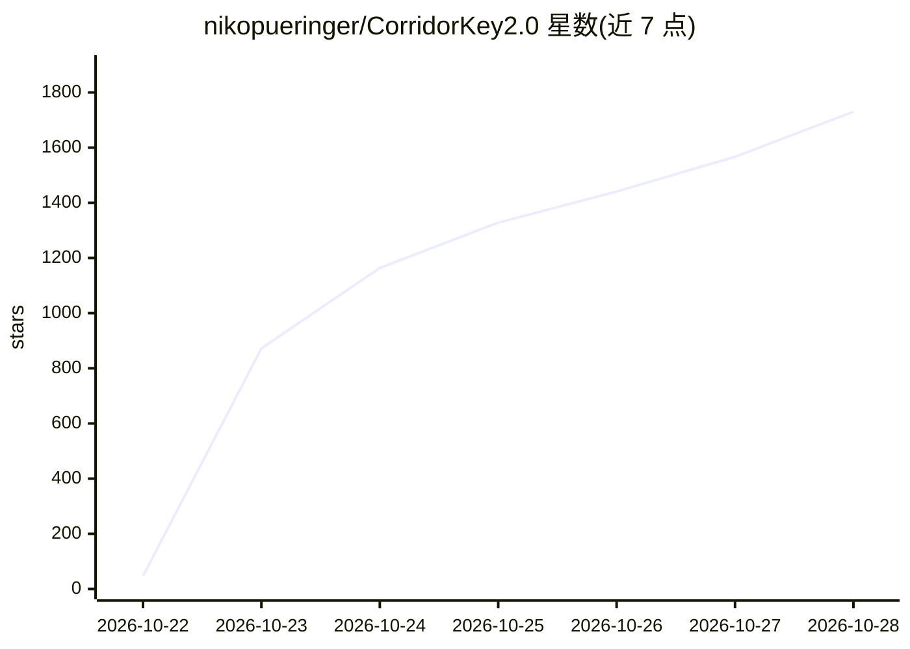

# nikopueringer/CorridorKey2.0

⭐ 1,814 · Python · NOASSERTION · 推送 2026-10-15 · [GitHub](https://github.com/nikopueringer/CorridorKey2.0) · [官网](https://corridorkey.com) · 个人维护

**面向绿幕/蓝幕抠像的 AI 视频 matte 生成工具，供 VFX 艺术家使用**

CorridorKey 2.0 是由 Zachary Harris 与 Corridor Digital 合作设计训练的绿幕/蓝幕抠像模型，读取视频输入，输出预测的 alpha matte、前景 RGB、checker 合成与 cutout 等结果。支持无提示、首帧提示、完整提示视频三种推理模式，提示质量参数控制模型对提示的信任程度。内部基于三个冻结基础模型（C-RADIOv4-SO400M、MoGe-2、RVM small），采用两阶段 Hann 时间窗口结构。要求 NVIDIA RTX 30 系及以上 GPU（1440p 需 4GB VRAM，4K 需 6GB）、ffmpeg 与 CUDA 版 PyTorch，权重约 5GB 从 Hugging Face 下载。支持 HDR EXR 场景线性输出。模型与软件可免费用于商业或个人工作，另有付费的商业插件版（corridorkey.com）。

## 筛选速览

| 维度 | 判定 | 备注 |
|---|---|---|
| AI 角色 | `ai-native` | 本体是模型或模型工具 |
| 许可风险 | `none` | NOASSERTION |
| 部署形态 | `library` | 以包/库形式分发 |
| 模型依赖 | — | README 未给出锁定关系 |
| 硬件要求 | — | 无带数字的原话,不猜 |
| 安装摩擦 | `medium` | 含编译或系统依赖之一 |
| 成熟度 | — | 结构信号不足 |

## 能力要点

- 三种推理模式：无提示/首帧提示/完整提示视频，hint_quality 控制提示信任度
- 两阶段 Hann 时间窗口结构，窗口大小按 GPU 空闲显存自动选择
- HDR EXR 场景线性输出，保留高于 1.0 与负值
- alpha/fg/checker/cutout 四种输出，despill 强度可调

## 适用场景

- 为绿幕/蓝幕素材自动生成 alpha matte 与前景抠像
- VFX 线性合成管线中输出场景线性 EXR 抠像结果
- 已有首帧 matte 或完整 roto 提示时进行时序跟踪抠像

## 场景标签

`图像视频处理` · 领域:感知与多模态

## 证据(README 行号)

> L3: Welcome to CorridorKey 2.0! You may rest easy, weary artist. The green beast has been slain. The CorridorKey 2.0 mod
> L86: - `alpha`: predicted matte as a video preview.

## 星数曲线

2026-10-22 47 → 2026-10-28 1,730（+1,683）

---
*卡片 v1 · prompt 1.4 · 生成 2026-10-22 · 置信度 mid · 依据 README sha `6a6bf1f975d7` · [字段定义](../../DATASET.md)*
