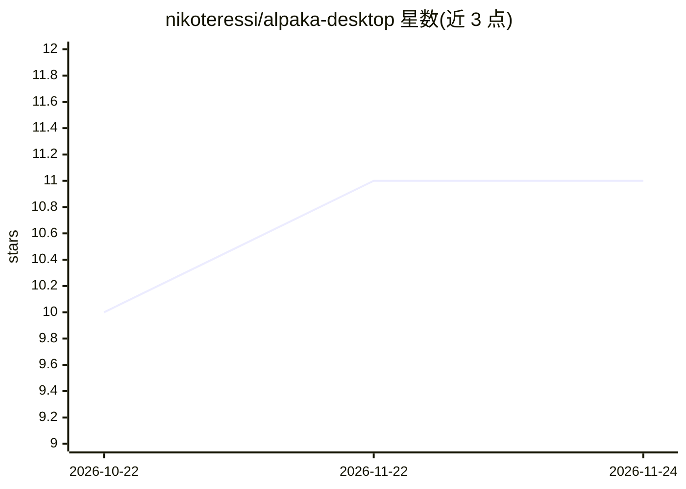

# nikoteressi/alpaka-desktop

⭐ 11 · TypeScript · MIT · 推送 2026-11-16 · [GitHub](https://github.com/nikoteressi/alpaka-desktop) · [官网](https://nikoteressi.github.io/alpaka-desktop/) · 个人维护

**Linux 原生 Ollama 桌面客户端（Tauri 构建）**

面向 Linux 桌面的 Ollama 客户端，使用 Tauri v2 与 Vue 3 构建，针对 KDE Plasma 与 Wayland 设计。功能包括流式 Markdown 渲染、思维链折叠面板、滑动窗口上下文压缩、多 Ollama 主机管理与健康检查、模型拉取/删除/Modelfile 创建、密钥存入系统 Secret Service、网页搜索工具调用循环、文件夹与图片多模态输入、SQLite 备份恢复。提供 AppImage、APT 仓库、AUR 安装包及源码构建路径。

## 筛选速览

| 维度 | 判定 | 备注 |
|---|---|---|
| AI 角色 | `ai-ecosystem` | LLM/agent 周边工具 |
| 许可风险 | `permissive` | MIT |
| 部署形态 | `desktop` | 安装包/桌面程序 |
| 模型依赖 | local-ok | 支持本地模型 |
| 硬件要求 | — | 无带数字的原话,不猜 |
| 安装摩擦 | `low` | 无编译、无系统依赖或容器化 |
| 成熟度 | — | 结构信号不足 |

## 能力要点

- 多主机管理：本地/LAN/云 Ollama 端点，30 秒后台健康检查
- 模型管理：拉取、删除、收藏及从 Modelfile 创建自定义模型
- API 密钥存入系统 Secret Service（KWallet/GNOME Keyring/KeePassXC）
- 内置网页搜索工具调用循环（最多 5 轮迭代）

## 适用场景

- 在 Linux 桌面本地运行和对话 Ollama 模型
- 管理多个本地/局域网/云端 Ollama 端点
- 为支持视觉的模型发送图片输入
- 管理本地模型库与自定义 Modelfile

## 场景标签

`聊天机器人` `AI 助手` · 领域:对话与助手

## 证据(README 行号)

> L5:  A native, first-class Ollama desktop client for Linux.
> L6:  Built with Tauri v2 and Vue 3, designed for KDE Plasma and Wayland.
> L13: Alpaka Desktop is a local-first AI interface that brings the power of
> L117: - **Ollama** running locally or on a reachable host.

## 星数曲线

2026-10-22 10 → 2026-11-24 11（+1）

---
*卡片 v1 · prompt 1.4 · 生成 2026-11-19 · 置信度 high · 依据 README sha `a7bd8dd2569a` · [字段定义](../../DATASET.md)*
