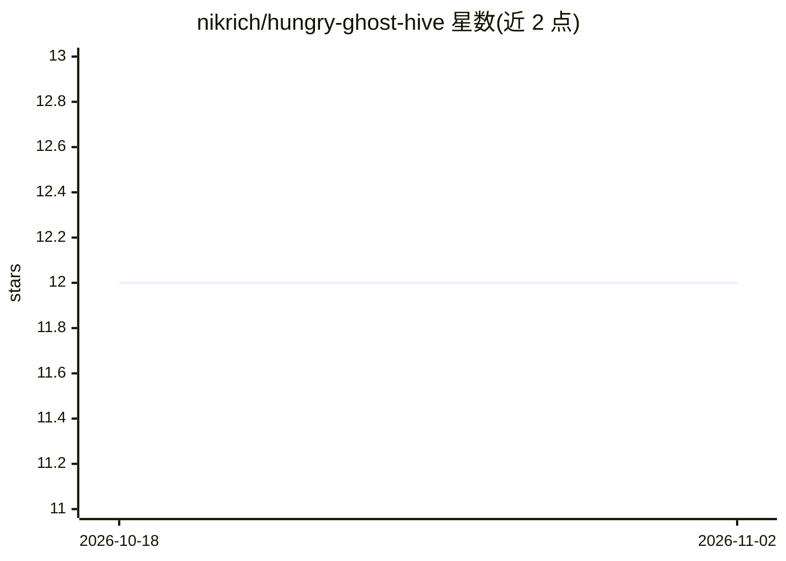

# nikrich/hungry-ghost-hive

⭐ 12 · TypeScript · NOASSERTION · 推送 2026-03-30 · [GitHub](https://github.com/nikrich/hungry-ghost-hive) · 个人维护

**按敏捷团队模式编排 AI 代理的 CLI：需求到合并 PR**

Node.js/TypeScript 编写的 CLI 编排工具，将 AI 代理组织为敏捷开发团队：用户以 Product Owner 身份提交需求，Tech Lead 代理拆解为带依赖的故事，按复杂度评分（Fibonacci 1-13）路由到 Junior/Intermediate/Senior 代理，QA 代理自动审查 PR 并执行质量检查，通过后自动合并；代理在独立 git worktree 与 tmux 会话中运行，可选用 Claude Code、Codex 或 Gemini CLI 作为运行时。含 Manager 守护进程（卡死检测、孤儿恢复）、Jira 双向同步与基于 RAFT 的分布式集群模式。状态存储于 SQLite。

## 筛选速览

| 维度 | 判定 | 备注 |
|---|---|---|
| AI 角色 | `ai-ecosystem` | LLM/agent 周边工具 |
| 许可风险 | `none` | NOASSERTION |
| 部署形态 | `library` | 以包/库形式分发 |
| 模型依赖 | — | README 未给出锁定关系 |
| 硬件要求 | — | 无带数字的原话,不猜 |
| 安装摩擦 | `low` | 无编译、无系统依赖或容器化 |
| 成熟度 | — | 结构信号不足 |

## 能力要点

- 需求→故事→PR→自动合并的端到端代理工作流
- 按 Fibonacci 复杂度评分将故事路由到不同级别代理
- QA 代理自动审查 PR、运行 lint/测试并校验验收标准
- RAFT 领导者选举的分布式集群模式与 Jira 双向同步

## 适用场景

- 让 AI 代理团队自动完成从需求到合并 PR 的开发流程
- 多仓库场景下协调 AI 代理并行开发
- 将代理工作流与 Jira 的史诗、故事、冲刺管理对接

## 场景标签

`多智能体` `编码 Agent` · 领域:Agent 开发

## 证据(README 行号)

> L12: Hive is a CLI tool that orchestrates AI agents modeled after agile software development teams. You act as the **Pro
> L16: - **AI-Powered Team Management**: Orchestrate autonomous teams of AI agents across multiple repositories
> L28: - **Multi-CLI Support**: Agents can use Claude Code, Codex, or Gemini CLI as their runtime

## 星数曲线

2026-10-18 12 → 2026-11-02 12（+0）

---
*卡片 v1 · prompt 1.4 · 生成 2026-11-01 · 置信度 high · 依据 README sha `edcd44e51ce2` · [字段定义](../../DATASET.md)*
