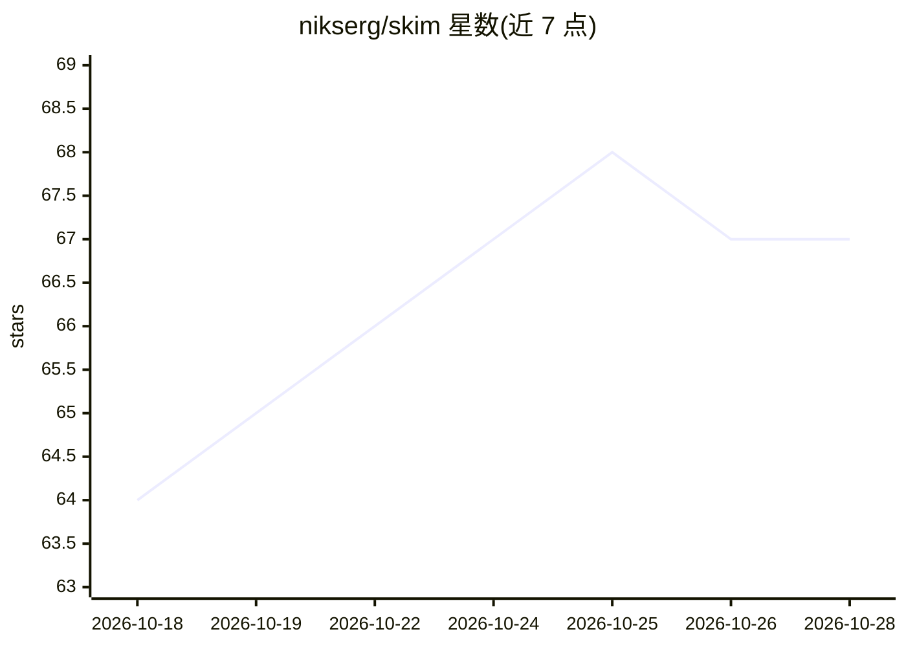

# nikserg/skim

⭐ 67 · Rust · MIT · 推送 2026-10-25 · [GitHub](https://github.com/nikserg/skim) · [官网](https://skim-tech.com/) · 个人维护

**Windows 原生 AI 邮件客户端，BYOK 助手起草与总结邮件**

用 Rust 与 Tauri 2 构建的 Windows 桌面邮件客户端，安装包约 5 MB、无需管理员权限。邮件功能覆盖 Gmail/Outlook/Yahoo/iCloud 及任意 IMAP/SMTP，支持 OAuth 与应用密码、多账户、会话线程、离线队列与 SQLite FTS5 全文搜索。AI 为可选增强：用户自带 API key（Anthropic、OpenRouter 或任意 OpenAI 兼容端点，含本地 Ollama/LM Studio/vLLM）后获得代笔、润色、邮件问答、邮箱对话与未读摘要等能力；无 key 时仍可作为普通邮件客户端使用。密钥存于 Windows Credential Manager，请求直连提供商。

## 筛选速览

| 维度 | 判定 | 备注 |
|---|---|---|
| AI 角色 | `ai-enhanced` | 去掉 AI 部分产品仍成立 |
| 许可风险 | `permissive` | MIT |
| 部署形态 | `desktop` | 安装包/桌面程序 |
| 模型依赖 | local-ok | 支持本地模型 |
| 硬件要求 | — | 无带数字的原话,不猜 |
| 安装摩擦 | `low` | 无编译、无系统依赖或容器化 |
| 成熟度 | — | 结构信号不足 |

## 能力要点

- BYOK AI：支持 Anthropic、OpenRouter 及任意 OpenAI 兼容端点（含本地 Ollama/LM Studio/vLLM）
- 按个人写作风格代笔，分析最近 100 封已发邮件匹配语气
- 本地 SQLite 缓存 + FTS5 全文搜索，离线可用，零遥测
- HTML 邮件在 Rust 端消毒并渲染于沙箱 iframe，脚本不执行

## 适用场景

- 在轻量原生客户端里收发邮件并让 AI 按我的语气代笔回复
- 用 AI 一键总结 20 封未读邮件并按需回复排序
- 用自己的 key（含本地模型）在邮件中使用 AI，数据不出本机

## 场景标签

`AI 写作` `AI 助手` · 领域:对话与助手

## 证据(README 行号)

> L7: Minimalist, native, fast. Bring your own AI key for the assistant and co-writer. No subscriptions, free forever.
> L40: - ✦ **AI on your terms.** Paste your own key — Anthropic (Claude), OpenRouter for models from any vendor (Claude, G

## 星数曲线

2026-10-18 64 → 2026-10-28 67（+3）

---
*卡片 v1 · prompt 1.4 · 生成 2026-10-24 · 置信度 mid · 依据 README sha `94b038bc642f` · [字段定义](../../DATASET.md)*
