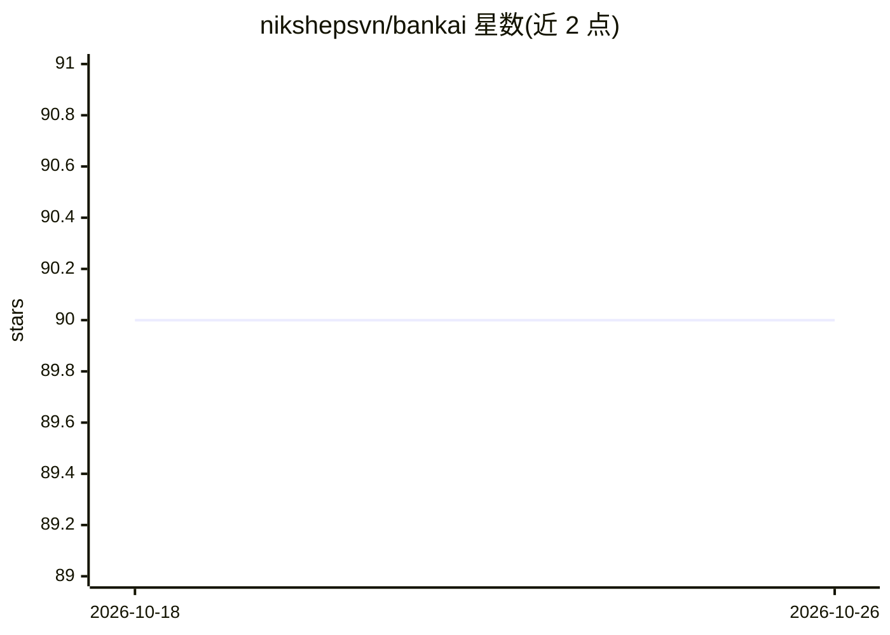

# nikshepsvn/bankai

⭐ 90 · Python · Apache-2.0 · 推送 2026-08-06 · [GitHub](https://github.com/nikshepsvn/bankai) · [官网](https://github.com/nikshepsvn/bankai) · 个人维护

**面向真 1-bit LLM 的 XOR 稀疏补丁后训练适配方法与工具包**

研究项目：为权重为单比特的真 1-bit LLM（如 Bonsai 8B）提供首个后训练适配方法。以稀疏 XOR 位掩码补丁原位修改二值权重，补丁仅约 1 KB、施加微秒级、推理零开销、可用同一 XOR 操作撤销。提供 MLX（Apple Silicon）与 GGUF/CUDA（PrismML 的 llama.cpp fork 上的 C++ 工具）两种后端，以及可复现的补丁创建、施加与评测工具包和 JSON 补丁格式。自述为早期研究，实验结论含更正记录（实验 6 数字已被实验 12 修订），行级翻转粒度与行为可组合性被列为未验证限制。

## 筛选速览

| 维度 | 判定 | 备注 |
|---|---|---|
| AI 角色 | `ai-ecosystem` | LLM/agent 周边工具 |
| 许可风险 | `permissive` | Apache-2.0 |
| 部署形态 | `library` | 以包/库形式分发 |
| 模型依赖 | local-ok | 支持本地模型 |
| 硬件要求 | — | 无带数字的原话,不猜 |
| 安装摩擦 | `medium` | 含编译或系统依赖之一 |
| 成熟度 | `idea` | |

## 能力要点

- 稀疏 XOR 补丁原位修改 1-bit 权重，840–1,116 字节、推理零开销
- MLX 与 GGUF/CUDA 双后端，同一 JSON 补丁可跨后端施加
- 尺度引导的位翻转定位，比随机翻转行为影响高 3.88x
- 提供补丁格式与可复现的搜索/施加/评测工具链

## 适用场景

- 为已部署的 1-bit 模型修复特定失败或做领域特化
- 在手机等设备上以约 1KB/补丁维护可热切换的领域补丁库
- 研究二值架构的层级功能特化与补丁可组合性

## 场景标签

`模型评测` · 领域:评测与运维

## 证据(README 行号)

> L33: True 1-bit LLMs have no post-training adaptation method — LoRA, fine-tuning, and QAT all require continuous weights
> L82: 4. **A toolkit and patch format** for reproducible XOR patch creation, application, and evaluation.
> L104: Bankai has two backend implementations: **MLX** (Apple Silicon, via PrismML's MLX fork with 1-bit kernels) and **G

## 星数曲线

2026-10-18 90 → 2026-10-26 90（+0）

---
*卡片 v1 · prompt 1.4 · 生成 2026-10-23 · 置信度 high · 依据 README sha `1791603ff19d` · [字段定义](../../DATASET.md)*
