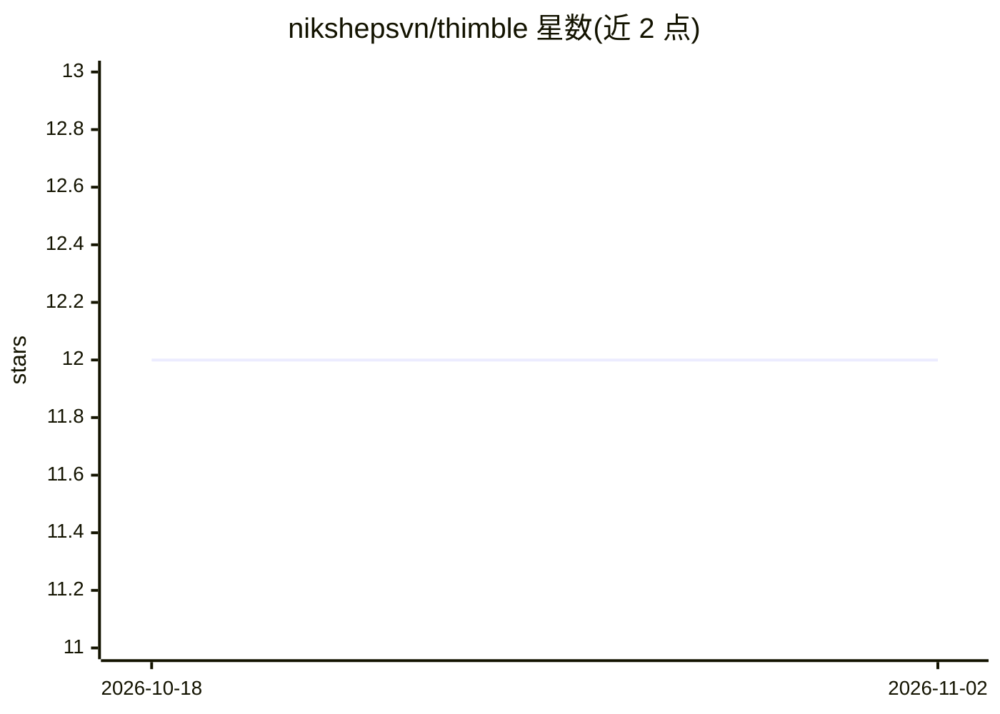

# nikshepsvn/thimble

⭐ 12 · Python · MIT · 推送 2026-08-25 · [GitHub](https://github.com/nikshepsvn/thimble) · [官网](https://huggingface.co/flashvenom/thimble) · 个人维护

**48M 参数的函数调用专用小模型：输入 schema，输出结构化合法调用**

面向边缘与低延迟场景的工具调用层：读取类型化函数目录与请求，返回经验证的调用列表或空列表。核心机制是把分词器、训练损失与解码器围绕五个决策点共同设计，由 schema 编译出的语法保证输出恒为合法 JSON、参数名与工具名不可越界幻觉。提供 Python 训练/评测栈、可适配自有目录的三阶段流程（需 OpenRouter 与 GPU），以及单文件依赖无关的 C 推理引擎与 int8 量化（48MB 权重）。局限：仅适合抽取式命令型请求，对话式表述、可选参数与校准拒绝为已记录弱项；第三方目录的端到端适配尚未演示。

## 筛选速览

| 维度 | 判定 | 备注 |
|---|---|---|
| AI 角色 | `ai-native` | 本体是模型或模型工具 |
| 许可风险 | `permissive` | MIT |
| 部署形态 | `library` | 以包/库形式分发 |
| 模型依赖 | — | README 未给出锁定关系 |
| 硬件要求 | — | 无带数字的原话,不猜 |
| 安装摩擦 | `low` | 无编译、无系统依赖或容器化 |
| 成熟度 | `idea` | |

## 能力要点

- 语法编译自 schema：输出恒为合法 JSON，未声明工具与幻觉参数名在结构上不可产生
- 48M 参数 int8 权重 48MB，单文件 C 引擎可在浏览器/笔记本/手机运行
- adapt.py 三阶段（synth/pack/train）支持适配自有工具目录
- route/ 本地调度器（约130ms）可作为 agent 快路径，附带置信度门控

## 适用场景

- 在内存或延迟受限的边缘设备上做函数调用
- 把自然语言命令映射到自有 API 目录的验证调用
- 作为大模型的本地快速路径，仅当调度器弃权时回退大模型

## 场景标签

`推理引擎` `模型量化` · 领域:训练与推理

## 证据(README 行号)

> L15: It does not converse, reason, or write prose — it was never trained to. It reads
> L16: a catalog of typed functions and a request, and returns the calls to make or an
> L37: The model is consulted at exactly five choice points: refuse-or-call, which tool,

## 星数曲线

2026-10-18 12 → 2026-11-02 12（+0）

---
*卡片 v1 · prompt 1.4 · 生成 2026-11-01 · 置信度 high · 依据 README sha `b52df76c36e7` · [字段定义](../../DATASET.md)*
