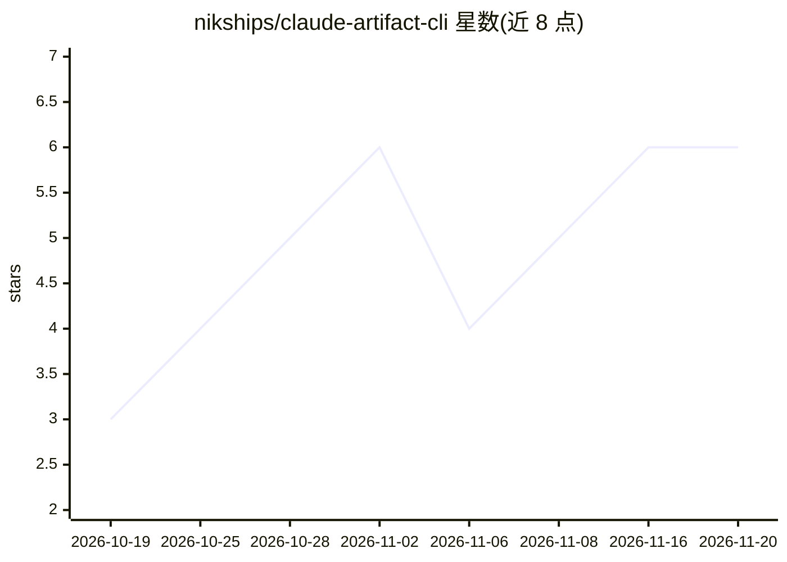

# nikships/claude-artifact-cli

⭐ — · [GitHub]() · 个人维护

**终端发布/管理 Claude Artifacts 的 CLI 工具**

一个 Python CLI，将 HTML 页面（含 CSS/JS/图片）发布为 Claude Artifact 并输出链接，支持拉取文件回本地编辑后重发布，以及读写评论、数据库、上传资产、从类型（Slides/Docs/Dashboard 等）创建、声明运行时能力与分享/重命名/置顶/历史/删除。复用机器上已有的 claude.ai 登录（claude /login），调用与 Claude Code Artifact 工具相同的 API，无需 API key 与配置文件，仅依赖 Python 3.10+。用于内置工具之外的编码 agent、脚本、git hooks 与 CI。注意：非官方，使用私有未文档化 API。

## 筛选速览

| 维度 | 判定 | 备注 |
|---|---|---|
| AI 角色 | `ai-ecosystem` | LLM/agent 周边工具 |
| 许可风险 | `permissive` | — |
| 部署形态 | `library` | 以包/库形式分发 |
| 模型依赖 | — | README 未给出锁定关系 |
| 硬件要求 | — | 无带数字的原话,不猜 |
| 安装摩擦 | `low` | 无编译、无系统依赖或容器化 |
| 成熟度 | — | 结构信号不足 |

## 能力要点

- publish/pull/status 的本地-远端版本对比与合并（sha256 清单、冲突检测、退出码 3）
- 复用 Claude Code 登录，无需 API key 与配置文件，无 Python 3.10+ 之外的依赖
- 支持目录发布、.artifact.json 状态文件与 Typed artifact（Slides/Docs 等）
- 读写评论、数据库、资产，输出 --json 与 stdout/stderr 分离便于脚本化

## 适用场景

- 在其他编码 agent（Droid/Codex/Cursor/OpenCode）或子 agent 中发布和管理 Artifact
- 在 shell 脚本、Makefile、git hooks 与 CI 流水线中自动化 Artifact 发布
- 从本地编辑器拉取 Artifact 文件、修改后合并重发布

## 场景标签

 · 领域:开发者工具/AI 生态

## 证据(README 行号)

> L15: `claude-artifact` publishes an HTML page (plus any CSS, JS and images it uses) as a Claude Artifact and prints the 
> L17: Use it where the built-in tool can't reach: other coding agents (Droid, Codex, Cursor, OpenCode), subagents, shell 
> L25: uv tool install claude-artifact-cli     # or: pipx install claude-artifact-cli

## 星数曲线

2026-10-19 3 → 2026-11-20 6（+3）

---
*卡片 v1 · prompt 1.4 · 生成 2026-11-20 · 置信度 high · 依据 README sha `77a5ab8b64d6` · [字段定义](../../DATASET.md)*
