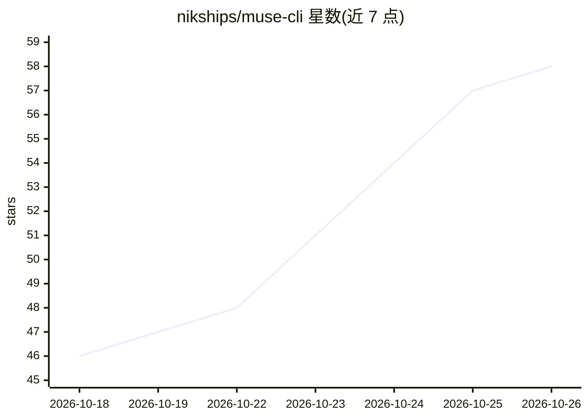

# nikships/muse-cli

⭐ 58 · Python · MIT · 推送 2026-10-22 · [GitHub](https://github.com/nikships/muse-cli) · [官网](https://muse-cli-site.web.app) · 个人维护

**muse.ai 个人 AI agent 的终端命令行客户端**

命令行工具，用于从终端与用户的 muse.ai 个人 AI agent 对话并管理 side chats、feed、goals、ideas、sessions 等数据，无需打开浏览器。直接实现 muse.ai 网关协议：HTTPS 认证后经加密 Noise-XX WebSocket 连接个人 VM；登录依赖从 Chrome 导出 cookie（借助 npm 的 agent-browser），也支持手工复制 cookie。所有命令输出 JSON，便于管道与脚本化，另附 258 个网关方法的 raw 逃生通道和供编码 agent 使用的技能文件。限制：依赖逆向的未版本化内部 API，可能变化。

## 筛选速览

| 维度 | 判定 | 备注 |
|---|---|---|
| AI 角色 | `ai-ecosystem` | LLM/agent 周边工具 |
| 许可风险 | `permissive` | MIT |
| 部署形态 | `library` | 以包/库形式分发 |
| 模型依赖 | — | README 未给出锁定关系 |
| 硬件要求 | — | 无带数字的原话,不猜 |
| 安装摩擦 | `low` | 无编译、无系统依赖或容器化 |
| 成熟度 | — | 结构信号不足 |

## 能力要点

- 直接实现 muse.ai 网关协议（HTTPS 认证 + Noise-XX 加密 WebSocket）
- 全部命令输出 JSON，可管道进 jq、cron 或其他 AI agent
- raw 命令可调用全部 258 个网关方法
- 附带 agent skill，编码 agent 可代替用户驱动 muse.ai agent

## 适用场景

- 在终端与 muse.ai 个人 agent 对话而不用浏览器
- 用脚本/cron 自动化 agent 交互并解析 JSON 输出
- 让编码 agent 通过技能代为操作自己的 muse.ai agent

## 场景标签

`AI 助手` · 领域:对话与助手

## 证据(README 行号)

> L16: A command-line client for your personal muse.ai AI agent: chat from the terminal, automate it with scripts, and man
> L18: - **Chat from the shell:** send a message and get the agent's reply back as JSON.
> L21: - **Agent-ready:** ships an agent skill so coding agents can drive your muse.ai agent for you.

## 星数曲线

2026-10-18 46 → 2026-10-26 58（+12）

---
*卡片 v1 · prompt 1.4 · 生成 2026-10-24 · 置信度 mid · 依据 README sha `93f143f62d99` · [字段定义](../../DATASET.md)*
