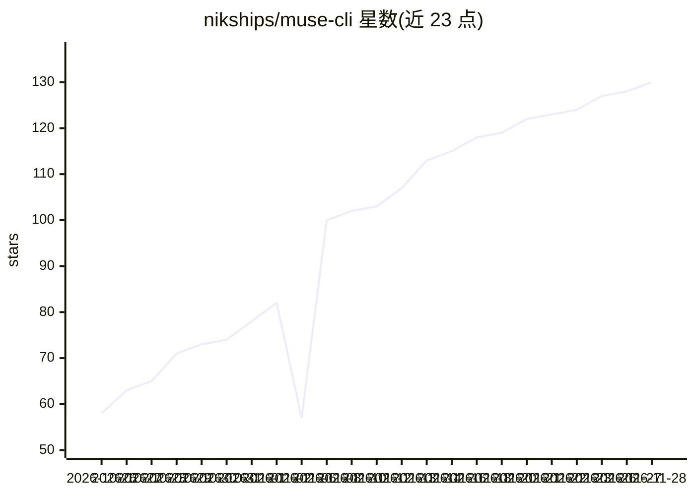

# nikships/muse-cli

⭐ 130 · Python · MIT · 推送 2026-11-27 · [GitHub](https://github.com/nikships/muse-cli) · [官网](https://muse-cli-web.web.app) · 个人维护

**在终端访问个人 muse.ai AI agent 的命令行客户端**

muse-cli 是连接 muse.ai 个人 AI agent 的命令行客户端：通过 HTTPS 认证加 Noise-XX 加密 WebSocket 直连用户的个人 VM，无需浏览器即可聊天、管理侧聊、feed、目标、想法与会话。所有命令输出 JSON，可管道进 jq、cron 或其他 AI agent；附带 agent skill 供编码 agent 代为驱动。全屏界面基于 OpenTUI，需 Bun 运行；登录依赖从浏览器导出的 muse.ai cookies。

## 筛选速览

| 维度 | 判定 | 备注 |
|---|---|---|
| AI 角色 | `ai-ecosystem` | LLM/agent 周边工具 |
| 许可风险 | `permissive` | MIT |
| 部署形态 | `library` | 以包/库形式分发 |
| 模型依赖 | — | README 未给出锁定关系 |
| 硬件要求 | — | 无带数字的原话,不猜 |
| 安装摩擦 | `low` | 无编译、无系统依赖或容器化 |
| 成熟度 | — | 结构信号不足 |

## 能力要点

- 全部命令输出 JSON，可脚本化并管道给 jq/cron/其他 agent
- 覆盖 402 个 gateway 方法，raw 命令可直调任意方法
- 附带 agent skill，编码 agent 可代为执行只读命令
- HTTPS 认证后经 Noise-XX 加密 WebSocket 直连个人 VM

## 适用场景

- 不开浏览器，在终端与个人 muse.ai agent 聊天
- 用脚本/cron 自动化调用 agent 任务
- 让编码 agent 通过 skill 代为查询 agent 状态与目标

## 场景标签

`AI 助手` `聊天机器人` · 领域:对话与助手

## 证据(README 行号)

> L16: A command-line client for your personal muse.ai AI agent: chat from the terminal, automate it with scripts, and man
> L19: - **Chat from the shell:** send a message and get the agent's reply back as JSON.
> L22: - **Agent-ready:** ships an agent skill so coding agents can drive your muse.ai agent for you.

## 星数曲线

2026-10-26 58 → 2026-11-28 130（+72）

---
*卡片 v1 · prompt 1.4 · 生成 2026-11-28 · 置信度 mid · 依据 README sha `446de3c17cc4` · [字段定义](../../DATASET.md)*
