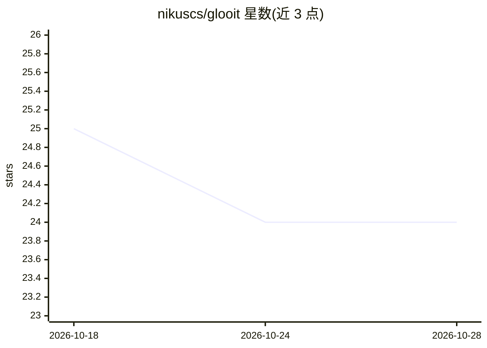

# nikuscs/glooit

⭐ 24 · TypeScript · 推送 2026-05-12 · [GitHub](https://github.com/nikuscs/glooit) · 个人维护

**跨 AI 编码助手同步规则/MCP/Skills/命令配置的 CLI 工具**

面向多 AI 编码工具团队的配置同步 CLI：在 .agents/ 下用单一 TypeScript 配置定义规则、命令、技能、Agent、MCP 服务器、生命周期钩子与共享设置，通过 glooit sync 生成各工具原生格式（CLAUDE.md、.cursor/rules、AGENTS.md、.roo/rules 等），支持 Claude Code、Cursor、Codex、OpenCode、Factory、Roo Code/Cline 七种目标。提供 symlink 与 copy 两种模式（symlink 模式下转换与钩子不生效）、文件合并、glob 范围限定、占位符转换、同步前自动备份与密钥写入防护。安装支持 Homebrew 与 npm/npx。

## 筛选速览

| 维度 | 判定 | 备注 |
|---|---|---|
| AI 角色 | `ai-ecosystem` | LLM/agent 周边工具 |
| 许可风险 | `none` | — |
| 部署形态 | `library` | 以包/库形式分发 |
| 模型依赖 | — | README 未给出锁定关系 |
| 硬件要求 | — | 无带数字的原话,不猜 |
| 安装摩擦 | `low` | 无编译、无系统依赖或容器化 |
| 成熟度 | — | 结构信号不足 |

## 能力要点

- 单配置生成 7 种 AI 编码工具的原生配置文件
- 支持 Rules/Commands/Skills/Agents/MCP/Hooks/Settings 七类配置同步
- symlink 模式即时生效（但跳过 transforms/hooks）与自动备份
- 内置 __TIMESTAMP__/__ENV_VAR__/__STRUCTURE__ 等占位符转换

## 适用场景

- 团队成员各用不同 AI 助手但保持一致的编码规则
- Monorepo 中为不同包集中管理并分发规则
- CI/CD 流水线与开发环境共用同一套 agent 配置
- 切换或新增 AI 编码工具时无需重写配置

## 场景标签

 · 领域:开发者工具/AI 配置管理

## 证据(README 行号)

> L3: Sync AI coding assistant configurations across Claude Code, Cursor, Codex, OpenCode, and Roo Code/Cline.
> L59: Run `glooit sync` (or `bunx glooit sync` / `npx glooit sync`) and it creates:

## 星数曲线

2026-10-18 25 → 2026-10-28 24（-1）

---
*卡片 v1 · prompt 1.4 · 生成 2026-10-27 · 置信度 high · 依据 README sha `51db511ef28b` · [字段定义](../../DATASET.md)*
