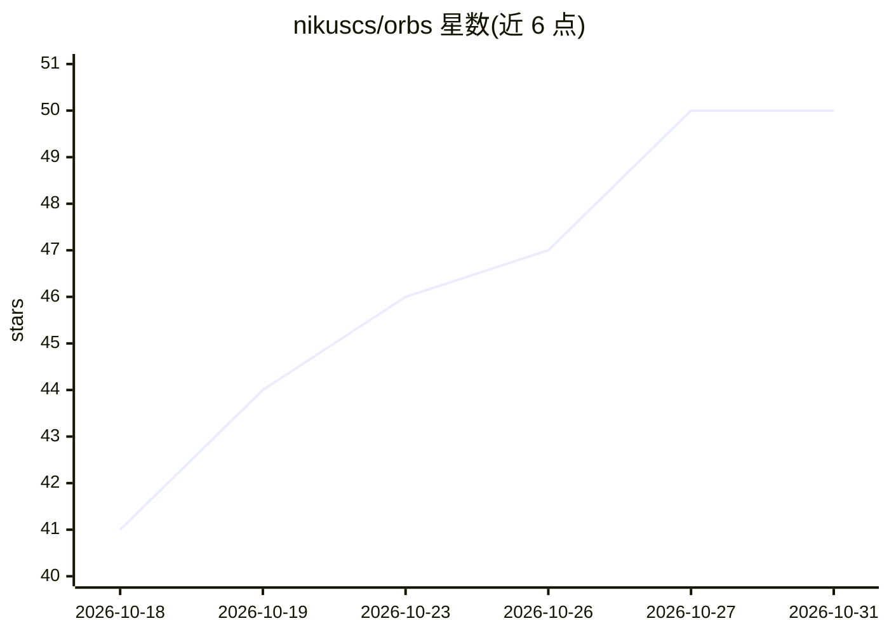

# nikuscs/orbs

⭐ 50 · TypeScript · MIT · 推送 2026-10-30 · [GitHub](https://github.com/nikuscs/orbs) · 个人维护

**自托管多机器人 AI 群聊：多模型机器人共用聊天室**

可自托管的多人多机器人聊天应用：房间内可放置多个机器人，各自绑定不同模型；@提及唤醒指定机器人，未提及时由 Jev（TypeSafe）评分决定谁回复。本机守护进程通过 Pi（pi --mode rpc，不随附）执行每轮对话，机器人可运行读写、bash 等工具。部署支持 Cloudflare（Workers/D1/R2/Durable Objects）或单个本地 Bun 进程（SQLite），自称是 Grok Bot、Muse 和 Dots 的开源替代。需自行准备 Bun 1.4.2 与 Pi 运行时，机器人工具非沙箱执行。

## 筛选速览

| 维度 | 判定 | 备注 |
|---|---|---|
| AI 角色 | `ai-native` | 本体是模型或模型工具 |
| 许可风险 | `permissive` | MIT |
| 部署形态 | `None` |  |
| 模型依赖 | — | README 未给出锁定关系 |
| 硬件要求 | — | 无带数字的原话,不猜 |
| 安装摩擦 | `low` | 无编译、无系统依赖或容器化 |
| 成熟度 | — | 结构信号不足 |

## 能力要点

- 房间内多机器人共存，各自可绑定不同模型（经 Pi 接入）
- Jev（TypeSafe）在无提及时评分选择回复者
- Cloudflare（Workers/D1/R2/DO）与本地单 Bun 进程两种托管方式
- 守护进程在本机以 RPC 模式驱动 Pi，机器人可执行工具

## 适用场景

- 我想自建一个多个 AI 机器人同室群聊的应用
- 给不同机器人配不同模型，在同一个房间里对比或协作
- 在本地或 Cloudflare 上自托管，不经第三方托管聊天数据

## 场景标签

`聊天机器人` · 领域:对话与助手

## 证据(README 行号)

> L3: > Multi-bot chat you run yourself. Jev picks who answers, and a daemon on your machine runs each turn through Pi.
> L7: An open-source, self-hosted alternative to Grok Bot, Muse and Dots: an AI group chat where several bots share one ro

## 星数曲线

2026-10-18 41 → 2026-10-31 50（+9）

---
*卡片 v1 · prompt 1.4 · 生成 2026-10-25 · 置信度 high · 依据 README sha `cd342c8dbee3` · [字段定义](../../DATASET.md)*
