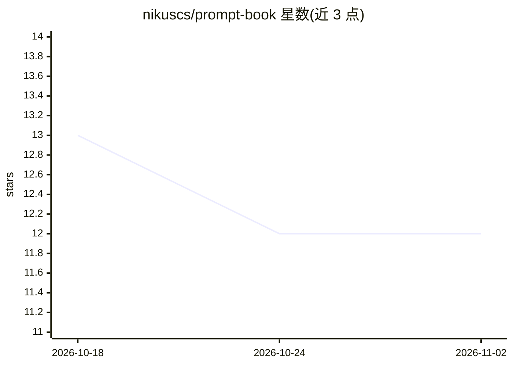

# nikuscs/prompt-book

⭐ 12 · TypeScript · 推送 2026-09-20 · [GitHub](https://github.com/nikuscs/prompt-book) · [官网](https://github.com/nikuscs/prompt-book/releases/latest) · 个人维护

**macOS 菜单栏 AI 提示词管理与快速复制工具**

基于 Tauri v2 + React 构建的 macOS 菜单栏应用：以弹出面板存储、搜索、编辑提示词并一键复制，需要时可打开完整编辑器窗口。提示词以 markdown 文件形式保存在 ~/.config/promptbook/，附带 index.json 管理排序与元数据，支持标题/内容自动保存与键盘快捷键。通过 GitHub Releases 提供 Apple Silicon 版 .dmg 安装包，也可用 Rust、Bun 与 Xcode 命令行工具从源码构建运行。

## 筛选速览

| 维度 | 判定 | 备注 |
|---|---|---|
| AI 角色 | `ai-ecosystem` | LLM/agent 周边工具 |
| 许可风险 | `none` | — |
| 部署形态 | `desktop` | 安装包/桌面程序 |
| 模型依赖 | — | README 未给出锁定关系 |
| 硬件要求 | — | 无带数字的原话,不猜 |
| 安装摩擦 | `low` | 无编译、无系统依赖或容器化 |
| 成熟度 | — | 结构信号不足 |

## 能力要点

- 菜单栏弹出面板快速搜索与复制提示词
- 提示词以 markdown 文件落盘存储于 ~/.config/promptbook/
- 标题/内容自动保存与键盘快捷键
- 提供 macOS Apple Silicon 的 .dmg 安装包

## 适用场景

- 在菜单栏快速查找并复制常用 AI 提示词
- 集中管理并编辑个人提示词库
- 在多个 AI 工具间复用整理好的提示词

## 场景标签

`提示工程` · 领域:Agent 开发

## 证据(README 行号)

> L3: Fast macOS menu-bar prompt library built with Tauri v2 + React.
> L5: Store, search, edit, and instantly copy prompts from a compact menu-bar popover, with a full editor window when need

## 星数曲线

2026-10-18 13 → 2026-11-02 12（-1）

---
*卡片 v1 · prompt 1.4 · 生成 2026-11-01 · 置信度 mid · 依据 README sha `f376645398ce` · [字段定义](../../DATASET.md)*
