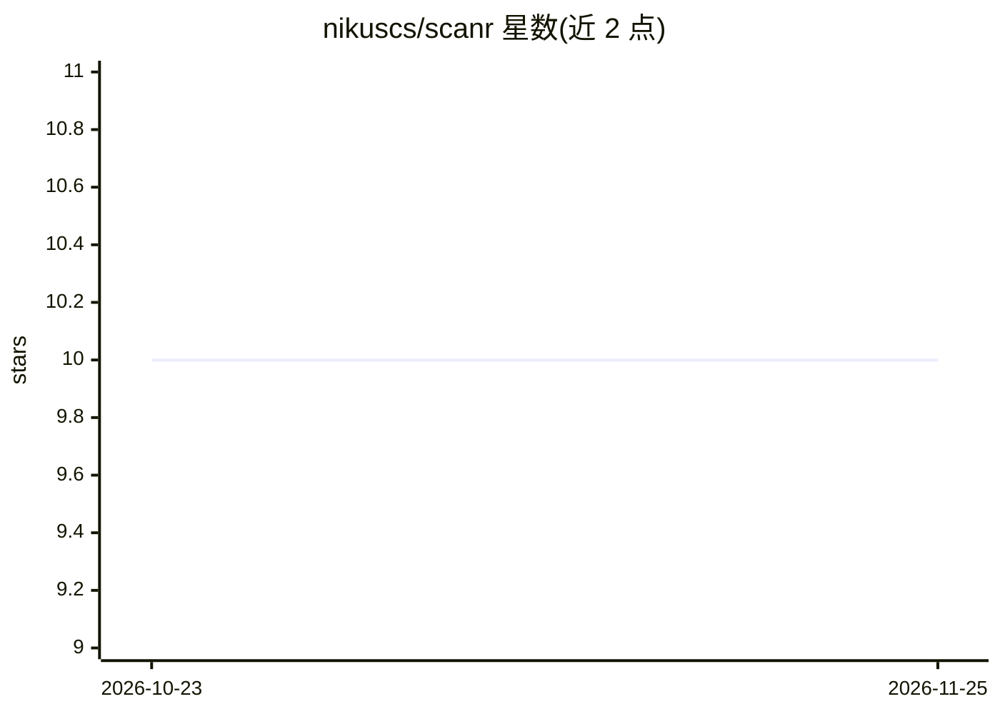

# nikuscs/scanr

⭐ 10 · JavaScript · MIT · 推送 2026-11-17 · [GitHub](https://github.com/nikuscs/scanr) · 个人维护

**TypeScript/JS 项目的离线静态分析与搜索 CLI**

以单个本地二进制形式提供的 TypeScript/JavaScript 静态分析工具：基于 oxc 提取函数、绑定、引用与导出，生成文件大纲、依赖图、名称清单与引用位置，并支持基于 APTED 的函数/类型相似度检测、类型解析重命名（需 bun 或 node 与 tsconfig.json）、gitignore 感知的并行内容/路径搜索，以及针对代码评审的确定性检查信号。无数据库、无网络访问、无 API key，输出为确定性 JSON，README 说明适合脚本与 coding agents 消费。

## 筛选速览

| 维度 | 判定 | 备注 |
|---|---|---|
| AI 角色 | `ai-ecosystem` | LLM/agent 周边工具 |
| 许可风险 | `permissive` | MIT |
| 部署形态 | `library` | 以包/库形式分发 |
| 模型依赖 | — | README 未给出锁定关系 |
| 硬件要求 | — | 无带数字的原话,不猜 |
| 安装摩擦 | `medium` | 含编译或系统依赖之一 |
| 成熟度 | — | 结构信号不足 |

## 能力要点

- oxc 驱动的结构分析：函数、捕获、绑定、引用、导出与内置规则检查
- APTED 相似度检测覆盖函数、接口、别名与类型字面量
- 基于 TypeScript 语言服务的类型准确重命名（依赖 bun/node）
- gitignore 感知并行搜索，输出稳定性排序的 JSON

## 适用场景

- 让 coding agents 读取确定性 JSON 输出来理解代码库结构
- 查找代码库中的重复/相似函数并做类型准确的符号重命名
- 对某个 git 基线做增量大纲 diff 与评审信号检查

## 场景标签

 · 领域:开发者工具/代码分析

## 证据(README 行号)

> L6: A fast, deterministic static-analysis and search CLI for TypeScript and JavaScript projects. `scanr` is a single loc
> L23: - **Agent-friendly** — deterministic output suitable for scripts and coding agents

## 星数曲线

2026-10-23 10 → 2026-11-25 10（+0）

---
*卡片 v1 · prompt 1.4 · 生成 2026-11-19 · 置信度 high · 依据 README sha `2b0eb514c6cb` · [字段定义](../../DATASET.md)*
