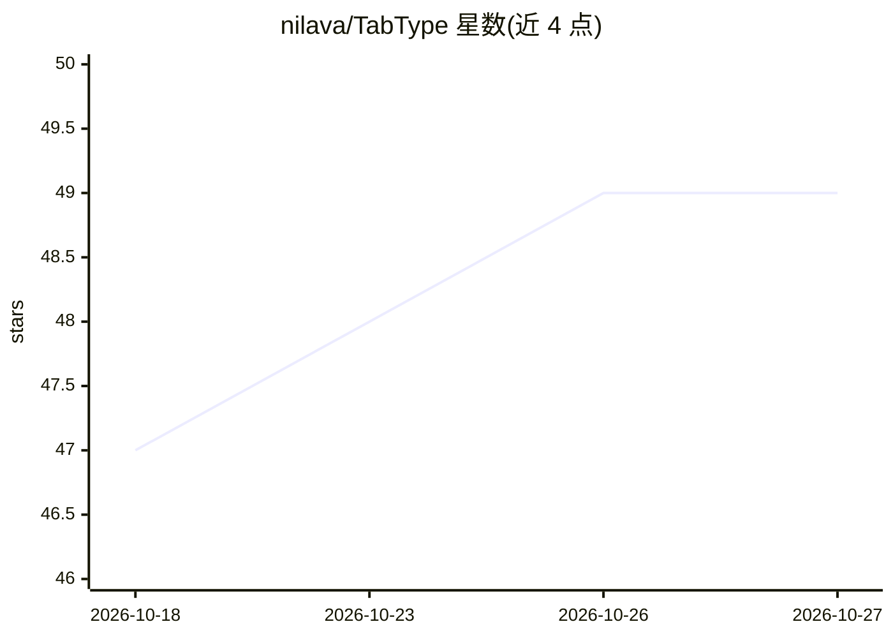

# nilava/TabType

⭐ 49 · Swift · MIT · 推送 2026-10-09 · [GitHub](https://github.com/nilava/TabType) · [官网](https://github.com/nilava/TabType/releases) · 个人维护

**macOS 全局 AI 文本补全：本地 LLM 逐词 ghost-text 预测**

面向 Mac 用户的输入补全应用：在几乎任意应用的输入框中显示半透明的 ghost-text 预测，按 Tab 逐词接受。使用 Qwen3 base 模型（GGUF，经 llama.cpp 在 Metal 上运行）在本机推理，无云端、无账号、无遥测；用置信度门控与 9 路短语束搜索决定是否显示建议。通过屏幕 OCR 与无障碍树读取输入框上方上下文，可选用 AES-GCM 加密的本地写作历史做个性化。要求 macOS 14+、Apple Silicon，状态为 Alpha，由个人开发者维护。

## 筛选速览

| 维度 | 判定 | 备注 |
|---|---|---|
| AI 角色 | `ai-native` | 本体是模型或模型工具 |
| 许可风险 | `permissive` | MIT |
| 部署形态 | `desktop` | 安装包/桌面程序 |
| 模型依赖 | local-ok | 支持本地模型 |
| 硬件要求 | — | 无带数字的原话,不猜 |
| 安装摩擦 | `low` | 无编译、无系统依赖或容器化 |
| 成熟度 | `idea` | |

## 能力要点

- 全应用内联 ghost-text 补全，字体/颜色取自目标应用
- 100% 本地推理（Qwen3 GGUF + llama.cpp/Metal），无遥测
- 9 路短语束搜索与分档置信度门控，弱猜测不显示
- 屏幕 OCR + 无障碍树读取上下文，历史 AES-GCM 加密存储

## 适用场景

- 在聊天、邮件、文档等任意应用中获得下一词预测
- 在不上云、不留痕的前提下使用 AI 输入补全
- 在终端 AI agent 提示词处获得补全（Claude Code/Codex/Gemini CLI）

## 场景标签

`AI 写作` · 领域:内容生成

## 证据(README 行号)

> L5: **TabType predicts your next words as you type — in almost any app — and runs entirely on your Mac. No cloud. No acc
> L38: As you type, TabType shows a dimmed **ghost-text** prediction of what comes next. Press **Tab** to accept a word, a

## 星数曲线

2026-10-18 47 → 2026-10-27 49（+2）

---
*卡片 v1 · prompt 1.4 · 生成 2026-10-25 · 置信度 high · 依据 README sha `0ba6cee6ccdd` · [字段定义](../../DATASET.md)*
