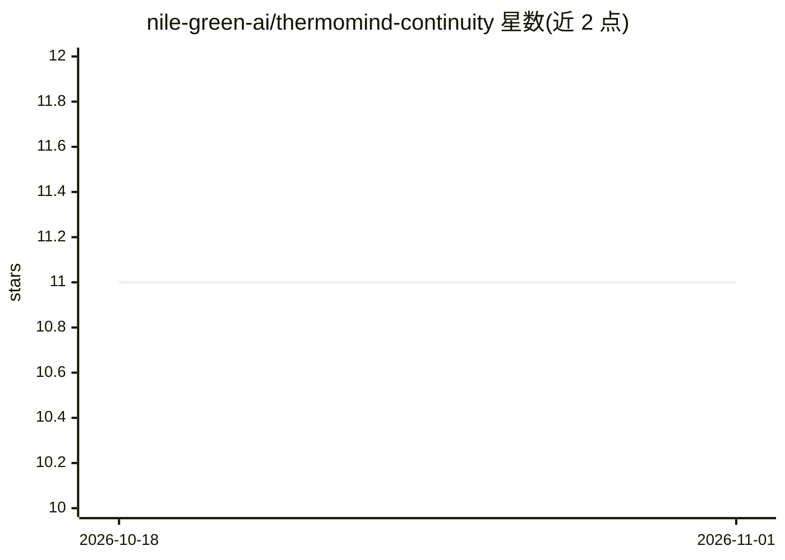

# nile-green-ai/thermomind-continuity

⭐ 11 · JavaScript · MIT · 推送 2026-07-19 · [GitHub](https://github.com/nile-green-ai/thermomind-continuity) · [官网](https://bapxai.com) · 个人维护

**给 LLM 应用的跨会话持久记忆层 SDK**

thermomind-continuity 是一个包裹现有 LLM 客户端的记忆层 SDK：以 2 行代码包装模型调用，由远端 ThermoMind 引擎在会话与进程重启间维持持久状态，第二回合可不发送聊天历史。引擎基于物理启发的状态机制（预测差距、能量动态、记忆显著度）决定保留内容，不依赖 RAG、向量库、微调或上下文窗口操作，也不改动模型权重。支持 Anthropic 与 OpenAI 兼容客户端（GPT/DeepSeek/Mistral），需申请免费 API key（每月 500 cycles 免费额度）。提供 JavaScript 与 Python 两种接入方式。

## 筛选速览

| 维度 | 判定 | 备注 |
|---|---|---|
| AI 角色 | `ai-ecosystem` | LLM/agent 周边工具 |
| 许可风险 | `permissive` | MIT |
| 部署形态 | `library` | 以包/库形式分发 |
| 模型依赖 | locked-api |  |
| 硬件要求 | `cpu-ok` | |
| 安装摩擦 | `low` | 无编译、无系统依赖或容器化 |
| 成熟度 | — | 结构信号不足 |

## 能力要点

- wrapClaude / wrapOpenAI 两行包装任意 LLM 客户端
- 零聊天历史下维持跨会话与跨进程重启的记忆
- 不依赖 RAG、向量数据库、微调或上下文窗口技巧
- 状态静态加密，对话不用于训练

## 适用场景

- 让我的 LLM 应用在不重放聊天历史的情况下保持长期记忆
- 跨进程和会话重启后仍保留对话的持续身份
- 在现有 Claude / DeepSeek / Mistral 调用上叠加持久记忆而不换模型

## 场景标签

`Agent 记忆` · 领域:Agent 开发

## 证据(README 行号)

> L5:  <code>thermomind-continuity</code> is a drop-in memory layer for any LLM.
> L65: The SDK sits between your app and whatever model you're already calling. It doesn't touch model weights or replace 

## 星数曲线

2026-10-18 11 → 2026-11-01 11（+0）

---
*卡片 v1 · prompt 1.4 · 生成 2026-11-01 · 置信度 mid · 依据 README sha `032ac5ebd3d1` · [字段定义](../../DATASET.md)*
