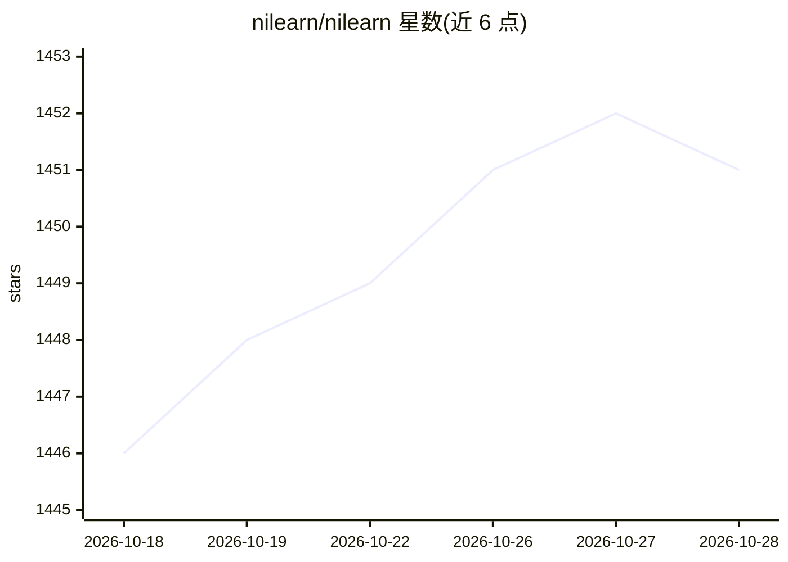

# nilearn/nilearn

⭐ 1,451 · Python · BSD-3-Clause · 推送 2026-10-28 · [GitHub](https://github.com/nilearn/nilearn) · [官网](http://nilearn.github.io) · 组织维护

**Python 脑影像（体积/表面）统计分析与机器学习库**

面向神经影像研究者的 Python 库，提供统计与机器学习工具，对脑体积与表面数据做分析：支持基于广义线性模型（GLM）的分析，并基于 scikit-learn 做多变量统计，应用于预测建模、分类、解码与连接性分析。绘图功能依赖 matplotlib，部分绘图函数可选 plotly+kaleido 引擎；测试需额外安装 pytest 等依赖。通过 pip 安装，配有文档与社区支持（每周线上答疑）。

## 筛选速览

| 维度 | 判定 | 备注 |
|---|---|---|
| AI 角色 | `ai-native` | 本体是模型或模型工具 |
| 许可风险 | `permissive` | BSD-3-Clause |
| 部署形态 | `library` | 以包/库形式分发 |
| 模型依赖 | — | README 未给出锁定关系 |
| 硬件要求 | — | 无带数字的原话,不猜 |
| 安装摩擦 | `low` | 无编译、无系统依赖或容器化 |
| 成熟度 | — | 结构信号不足 |

## 能力要点

- GLM 基于的脑体积/表面分析
- 基于 scikit-learn 的预测建模、分类、解码与连接性分析
- 支持 matplotlib 与可选 plotly 绘图引擎

## 适用场景

- 对 fMRI/脑影像数据做统计建模与解码分析
- 开展脑连接性（connectivity）分析
- 构建脑影像机器学习预测/分类流程

## 场景标签

`科研工具` · 领域:学习与行业

## 证据(README 行号)

> L42: Nilearn enables approachable and versatile analyses of brain volumes and surfaces.
> L45: It supports general linear model (GLM) based analysis
> L46: and leverages the `scikit-learn <https://scikit-learn.org>`_ Python toolbox

## 星数曲线

2026-10-18 1,446 → 2026-10-28 1,451（+5）

---
*卡片 v1 · prompt 1.4 · 生成 2026-10-21 · 置信度 high · 依据 README sha `61c1c43dcb67` · [字段定义](../../DATASET.md)*
