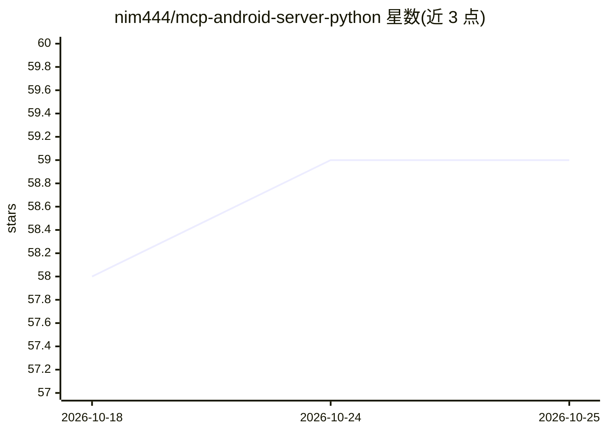

# nim444/mcp-android-server-python

⭐ 59 · Python · MIT · 推送 2025-11-21 · [GitHub](https://github.com/nim444/mcp-android-server-python) · 个人维护

**用自然语言控制 Android 设备的 MCP 服务器**

基于 uiautomator2 与 ADB 的 MCP 服务器，把 Android 设备操作封装为 MCP 工具：设备检测与状态查询、应用启停与数据清理、屏幕开关与解锁、点击/滑动/输入模拟、UI 元素检查、截图、UI 层级导出、Toast 捕获等。面向需要与真实设备交互的 AI agent（Claude Desktop、VS Code agent 模式、GitHub Copilot Chat 等），支持 stdio 与 Streamable HTTP 两种传输模式。要求 Python 3.13+、已安装 ADB 并连接开启 USB 调试的 Android 设备。

## 筛选速览

| 维度 | 判定 | 备注 |
|---|---|---|
| AI 角色 | `ai-ecosystem` | LLM/agent 周边工具 |
| 许可风险 | `permissive` | MIT |
| 部署形态 | `library` | 以包/库形式分发 |
| 模型依赖 | — | README 未给出锁定关系 |
| 硬件要求 | — | 无带数字的原话,不猜 |
| 安装摩擦 | `low` | 无编译、无系统依赖或容器化 |
| 成熟度 | — | 结构信号不足 |

## 能力要点

- 设备/应用/屏幕/输入/检查/高级六大类 MCP 工具集
- stdio 与 Streamable HTTP 双传输模式
- 提供 Claude Desktop 与 VS Code 的接入配置说明
- 支持 uiauto.dev UI 检查器集成

## 适用场景

- 让 Claude Desktop 或 VS Code agent 通过对话操作 Android 设备
- 构建 Android 自动化测试或远程设备控制流程
- 通过 HTTP API 在 Web 应用中调用设备自动化工具

## 场景标签

`GUI 自动化` · 领域:效率与自动化

## 证据(README 行号)

> L6: This project provides an **MCP (Model Context Protocol)** server for automating Android devices using uiautomator2. 
> L118: This is the standard mode for integrating with AI agents like Claude Desktop, VS Code, or other MCP clients.
> L164: ### For AI Agent Integration (Claude Desktop, VS Code, etc.)

## 星数曲线

2026-10-18 58 → 2026-10-25 59（+1）

---
*卡片 v1 · prompt 1.4 · 生成 2026-10-24 · 置信度 mid · 依据 README sha `08ad3f25db63` · [字段定义](../../DATASET.md)*
