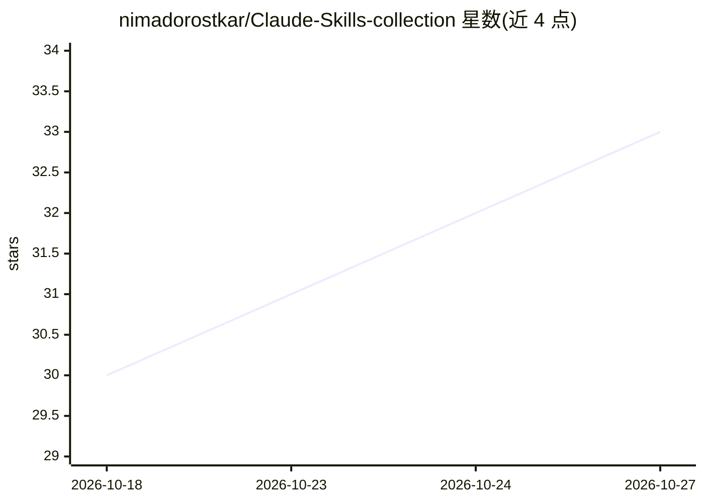

# nimadorostkar/Claude-Skills-collection

⭐ 33 · Python · MIT · 推送 2026-10-24 · [GitHub](https://github.com/nimadorostkar/Claude-Skills-collection) · [官网](https://github.com/nimadorostkar/Claude-Skills-collection) · 个人维护

**面向 Claude 等 AI 编码代理的 137 条技能策展库**

收录 137 个 SKILL.md 格式技能的策展库，覆盖工程、基础设施、AI、文档、设计、写作与金融等类别。技能是带 YAML frontmatter 的 Markdown 文件，由代理根据 description 字段自动加载以改变任务处理方式；收录标准是技能须实际改变代理输出，否则删除。安装方式包括 Claude Code 插件安装、git clone 后按类别或单个技能软链/复制，以及按项目提交共享；格式可被任何支持 skills 或能注入 Markdown 上下文的代理使用。

## 筛选速览

| 维度 | 判定 | 备注 |
|---|---|---|
| AI 角色 | `ai-knowledge` | 知识聚合/清单类 |
| 许可风险 | `permissive` | MIT |
| 部署形态 | `None` |  |
| 模型依赖 | — | README 未给出锁定关系 |
| 硬件要求 | — | 无带数字的原话,不猜 |
| 安装摩擦 | `low` | 无编译、无系统依赖或容器化 |
| 成熟度 | — | 结构信号不足 |

## 能力要点

- 137 个统一结构的 SKILL.md 技能，覆盖 7 个以上类别
- 按 description 自动加载，无 'install everything' 设计以省上下文
- 收录标准：技能须改变代理行为，输出不变则删除
- 支持插件安装、clone 软链、项目内共享三种安装途径

## 适用场景

- 为 Claude Code 按工作类别挑选安装编码/数据库/测试技能
- 让代理在排查慢接口、RAG 幻觉、PR 审查时自动加载对应技能
- 团队将共享技能提交进仓库统一使用

## 场景标签

`精选清单` · 领域:学习与行业

## 证据(README 行号)

> L11: A skill is a Markdown file that an agent loads when it becomes relevant — a compact briefing that changes how the a
> L133: **Will these work with agents other than Claude?**

## 星数曲线

2026-10-18 30 → 2026-10-27 33（+3）

---
*卡片 v1 · prompt 1.4 · 生成 2026-10-25 · 置信度 high · 依据 README sha `b7248d793f4e` · [字段定义](../../DATASET.md)*
