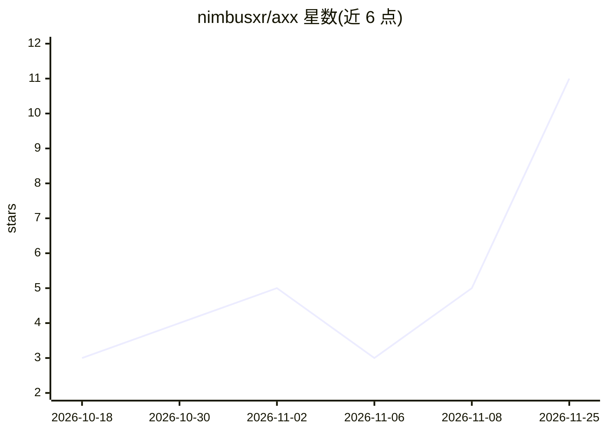

# nimbusxr/axx

⭐ 11 · Go · Apache-2.0 · 推送 2026-11-24 · [GitHub](https://github.com/nimbusxr/axx) · [官网](https://axx.nimbusxr.us) · 个人维护

**面向 agentic 软件的黑盒验收测试框架**

axx 定位为 agentic 软件工厂的行为验证层：一个验收测试框架，将运行中的软件对照可执行的验收标准进行黑盒验证，不依赖构建它的语言、架构或 agent。开发工作流基于 mise 管理工具版本，需 Docker 跑集成测试；从源码 git clone 后用 go build 构建。仓库提供 AGENTS.md、CONTRIBUTING.md（commit 签名与 conventional commits）与 SECURITY.md，采用 Apache-2.0 许可。安装与完整指南在 axx.nimbusxr.us。

## 筛选速览

| 维度 | 判定 | 备注 |
|---|---|---|
| AI 角色 | `ai-ecosystem` | LLM/agent 周边工具 |
| 许可风险 | `permissive` | Apache-2.0 |
| 部署形态 | `None` |  |
| 模型依赖 | — | README 未给出锁定关系 |
| 硬件要求 | — | 无带数字的原话,不猜 |
| 安装摩擦 | `low` | 无编译、无系统依赖或容器化 |
| 成熟度 | — | 结构信号不足 |

## 能力要点

- 黑盒验收测试，独立于语言、架构或构建它的 agent
- 将运行中的软件对照可执行验收标准进行验证
- 面向 agentic 软件工厂的行为验证层定位
- 开发流程含 race 检测测试、lint 与 schema 生成步骤

## 适用场景

- 为 agent 产出的软件建立可执行的验收标准
- 以黑盒方式验证生成软件的行为是否正确
- 团队规范化 agent 代码贡献的验收流程

## 场景标签

 · 领域:软件测试/质量保障

## 证据(README 行号)

> L7: **axx** ("axxeptance") is the open-source behavioral verification layer for agentic software
> L9: acceptance criteria, black-box, independent of the language, architecture or agent that built it.

## 星数曲线

2026-10-18 3 → 2026-11-25 11（+8）

---
*卡片 v1 · prompt 1.4 · 生成 2026-11-24 · 置信度 high · 依据 README sha `84fcd1058e9c` · [字段定义](../../DATASET.md)*
