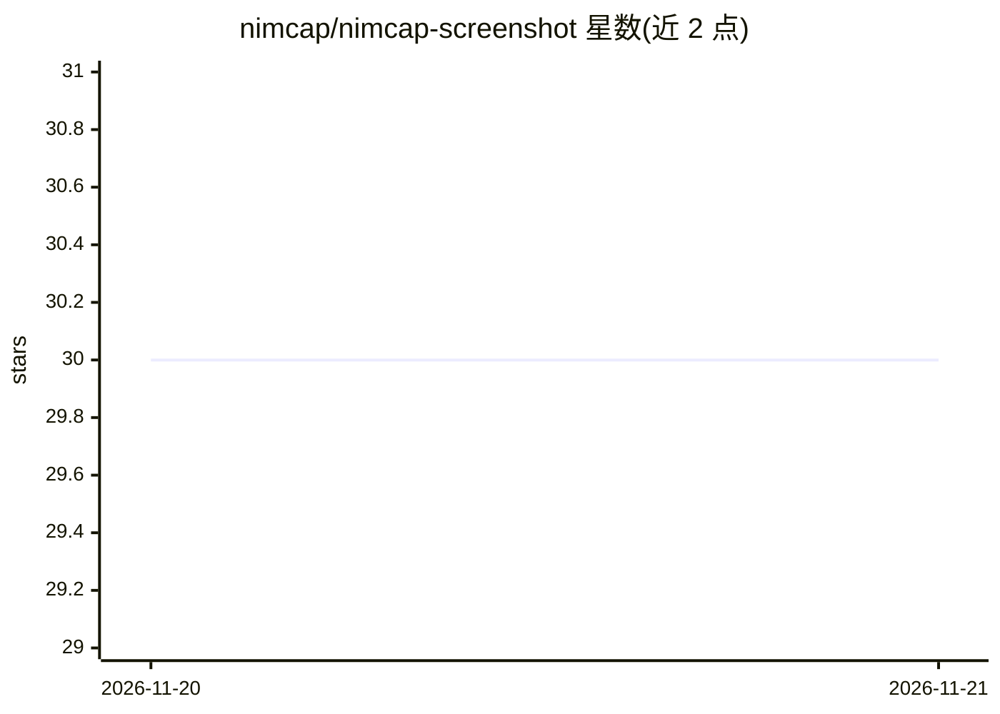

# nimcap/nimcap-screenshot

⭐ 30 · C# · Apache-2.0 · 推送 2026-11-20 · [GitHub](https://github.com/nimcap/nimcap-screenshot) · [官网](https://jietu.nimcap.com/) · 个人维护 · 中文 README

**Windows 离线截图工具：OCR、翻译、抠图、录屏一站式**

用 C#、WPF 和 .NET 10 开发的 Windows x64 桌面工具，驻留系统托盘、全局快捷键触发。功能覆盖区域/全屏/窗口截图、标注与一键脱敏、桌面贴图、滚动长截图、图片文字 OCR、证件字段提取、表格转 CSV/XLSX、公式转 LaTeX、二维码识别、本地翻译、抠图、取色测量与 MP4/GIF 录屏。OCR、表格、公式、抠图和翻译均可通过本地模型离线处理，数据留在本机；在线翻译与以图搜图默认关闭、逐次确认。从 GitHub Releases 下载发布包运行。

## 筛选速览

| 维度 | 判定 | 备注 |
|---|---|---|
| AI 角色 | `ai-enhanced` | 去掉 AI 部分产品仍成立 |
| 许可风险 | `permissive` | Apache-2.0 |
| 部署形态 | `desktop` | 安装包/桌面程序 |
| 模型依赖 | local-ok | 支持本地模型 |
| 硬件要求 | — | 无带数字的原话,不猜 |
| 安装摩擦 | `medium` | 含编译或系统依赖之一 |
| 成熟度 | — | 结构信号不足 |

## 能力要点

- 本地 OCR（PaddleOCR/Windows OCR/Tesseract）与本地翻译（Qwen3.5 + llama.cpp，CPU/Vulkan）
- 表格识别转 CSV/XLSX、公式转 LaTeX、证件字段提取均走本地模型
- 去水印提供 MI-GAN/LaMa/Moebius/SLBR 模型，软件内自动下载配置
- 支持无互联网的内网环境使用，图片与文字无需上传云端

## 适用场景

- 制作教程或反馈界面问题时截图标注
- 内网环境提取表格和公式而不外传数据
- 一键脱敏截图中的手机号、身份证号等敏感字段
- 录制操作演示为 MP4 或 GIF

## 场景标签

`OCR` · 领域:感知与多模态

## 证据(README 行号)

> L17: NimCap Screenshot 是用 C#、WPF 和 .NET 10 开发的 Windows x64 桌面工具。启动后驻留系统托盘，通过全局快捷键或托盘菜单工作，适合制作教程、反馈界面问题、整理图片资料、提取表格和公式，以及
> L9: NimCap Screenshot 已实现区域／全屏／当前窗口截图、元素选取、截图标注与一键脱敏、桌面贴图、滚动长截图、图片文字 OCR、证件字段提取、表格转 CSV／XLSX、公式转 LaTeX、二维码／条码识别、本地翻译、透明背

## 星数曲线

2026-11-20 30 → 2026-11-21 30（+0）

---
*卡片 v1 · prompt 1.4 · 生成 2026-11-20 · 置信度 high · 依据 README sha `040a0bc3915b` · [字段定义](../../DATASET.md)*
