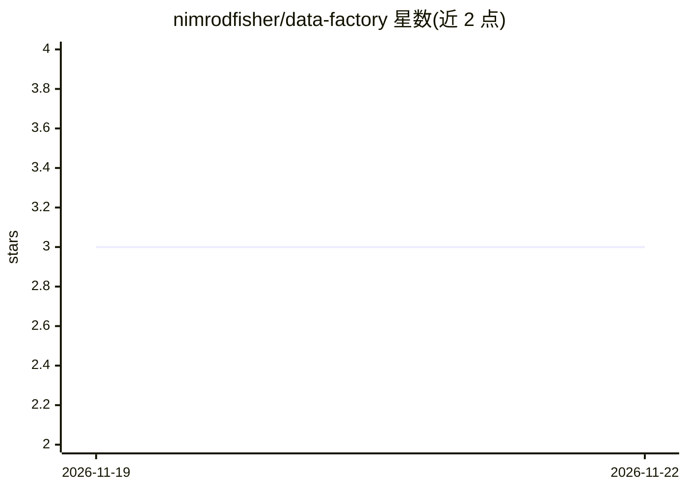

# nimrodfisher/data-factory

⭐ 3 · HTML · MIT · 推送 2026-11-18 · [GitHub](https://github.com/nimrodfisher/data-factory) · [官网](https://nimrodfisher.github.io/data-factory/) · 个人维护

**一人数据团队的 AI agent 集合：代理建管道并核验每个数字**

以 Claude Code 插件形式分发，内置数据工程、分析、数据科学与 BI 四个构建 agent 和一个质检 agent：用户用自然语言提出请求，系统先生成定义明确的 spec 供人批准，构建完成后由独立 inspector 通过密封保留测试与可信数字（truths.md）重算核验。工作流强调两道人工关卡（spec 批准、发布批准），用 hook 阻断破坏性 SQL 与生产写入。默认运行在受监督/门控自主档位；agents 为纯 markdown 文件，也可在 Codex、Cursor 等其他工具中使用。

## 筛选速览

| 维度 | 判定 | 备注 |
|---|---|---|
| AI 角色 | `ai-native` | 本体是模型或模型工具 |
| 许可风险 | `permissive` | MIT |
| 部署形态 | `library` | 以包/库形式分发 |
| 模型依赖 | locked-api |  |
| 硬件要求 | — | 无带数字的原话,不猜 |
| 安装摩擦 | `low` | 无编译、无系统依赖或容器化 |
| 成熟度 | — | 结构信号不足 |

## 能力要点

- spec→构建→独立质检→人工审批的软件工厂式流程
- inspector 从原始数据独立重算关键数字并做密封保留测试
- 5 个专业 agent（数据工程/分析/数据科学/BI/质检）按需加载知识
- 安全 hook 阻断 DROP/TRUNCATE/无界 DELETE 等破坏性操作

## 适用场景

- 让 AI 代理为我的数仓建 dbt 模型和数据管道
- 问'这个指标为什么下降'并拿到经过核验的答案
- 自动生成周度 KPI 报告或董事会预测
- 对现有分析结果做二次质检

## 场景标签

`编码 Agent` `数据分析` · 领域:效率与自动化

## 证据(README 行号)

> L24: **Data Factory is an open-source AI data team.** It's a Claude Code plugin with **AI agents for data engineering, a
> L30: 1. **You ask** in plain English → `/data-factory:run Why did MRR drop in August?`

## 星数曲线

2026-11-19 3 → 2026-11-22 3（+0）

---
*卡片 v1 · prompt 1.4 · 生成 2026-11-21 · 置信度 mid · 依据 README sha `d30df329c9e9` · [字段定义](../../DATASET.md)*
