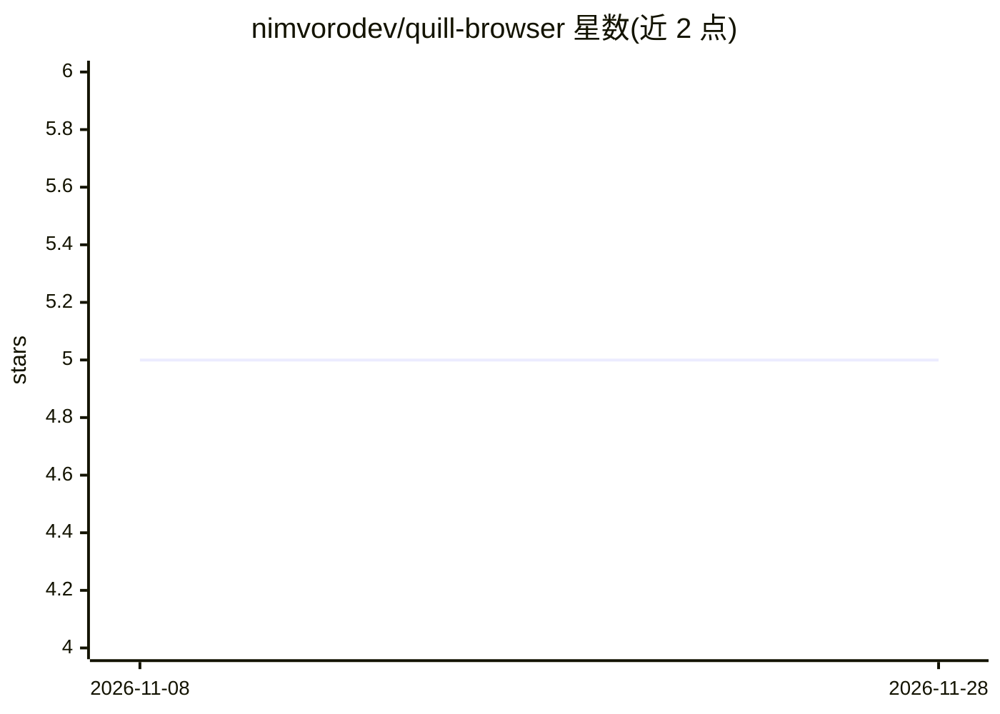

# nimvorodev/quill-browser

⭐ 5 · TypeScript · MPL-2.0 · 推送 2026-11-10 · [GitHub](https://github.com/nimvorodev/quill-browser) · [官网](https://nimvorodev.github.io/quill-browser/) · 个人维护

**注重隐私的桌面浏览器，可将网页重排为纸面阅读模式**

基于 Electron + React 的桌面浏览器：核心功能是把任意文章重排为无广告、无弹窗的纸面排版页，支持批注、便签、幽灵标签页、书签与 YouTube 专用视图；网络层拦截广告与跟踪器并提供拦截台账。内置离线摘录式摘要/翻译工具，可连接 Ollama 或 LM Studio 本地模型，也可填入 OpenAI 兼容接口的 key。所有数据保存在本地，无遥测、无账号。当前仅有 Windows 安装包，未签名；macOS/Linux 打包脚本未测试；无自动更新与扩展。

## 筛选速览

| 维度 | 判定 | 备注 |
|---|---|---|
| AI 角色 | `ai-enhanced` | 去掉 AI 部分产品仍成立 |
| 许可风险 | `permissive` | MPL-2.0 |
| 部署形态 | `desktop` | 安装包/桌面程序 |
| 模型依赖 | local-ok | 支持本地模型 |
| 硬件要求 | — | 无带数字的原话,不猜 |
| 安装摩擦 | `low` | 无编译、无系统依赖或容器化 |
| 成熟度 | — | 结构信号不足 |

## 能力要点

- re-ink 功能将文章重建为纸面排版，附目录与跟踪器审计
- 网络层拦截广告/跟踪器，台账记录每次被拦截的请求
- 离线摘录式摘要与翻译，可接 Ollama 或 LM Studio 本地模型
- 幽灵标签页浏览不留下历史记录

## 适用场景

- 在没有账号与云同步的前提下阅读网页文章
- 拦截广告与跟踪器并查看完整拦截记录
- 用本地模型对页面做离线摘要或翻译

## 场景标签

 · 领域:浏览器/桌面工具

## 证据(README 行号)

> L20: Quill is a desktop browser built around one idea: the web reads better on
> L58: - **A scribe in the margin, off the network.** Summarise or translate any page

## 星数曲线

2026-11-08 5 → 2026-11-28 5（+0）

---
*卡片 v1 · prompt 1.4 · 生成 2026-11-21 · 置信度 high · 依据 README sha `bc50f98ceae5` · [字段定义](../../DATASET.md)*
