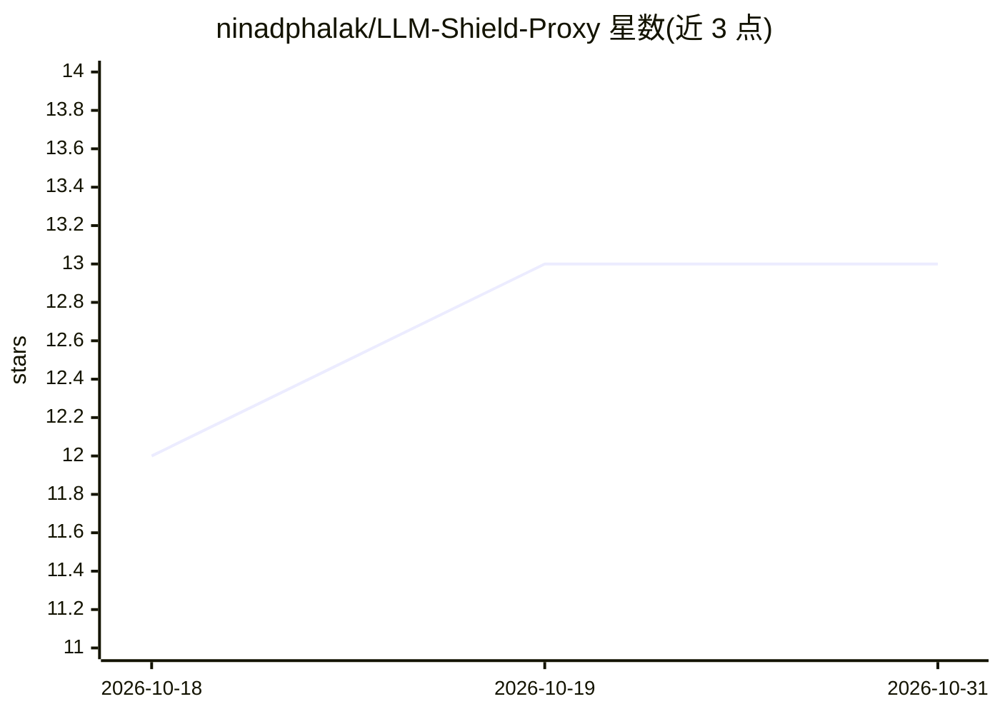

# ninadphalak/LLM-Shield-Proxy

⭐ 13 · Python · Apache-2.0 · 推送 2026-10-26 · [GitHub](https://github.com/ninadphalak/LLM-Shield-Proxy) · [官网](https://llmshieldproxy.com) · 个人维护

**面向 OpenAI 兼容 API 的自托管隐私脱敏网关及配套检测工具**

LLM-Shield-Proxy 是自托管的 LLM 隐私网关：请求发给模型提供商前检测并替换个人数据与密钥（邮箱、卡号、SSN、API key 等），在流式响应返回给应用前还原原值；应用只需改 base_url 和密钥。检测含 11 种原生类型、香农熵、可选 ONNX NER 与自定义规则；流式还原采用滑动窗口 SSE 重组与流式 JSON 词法处理。同仓库还含三个独立包：pii-leak-benchmark（测网关是否在流中泄露 PII）、mcp-ssrf-check（测 MCP 服务器 SSRF）、chunk-invariance（分块边界一致性测试）。LiteLLM 1.106.0 起内置该 Shield 作为 guardrail。README 明确标注基准结果均为维护者单次运行、未获独立复现。

## 筛选速览

| 维度 | 判定 | 备注 |
|---|---|---|
| AI 角色 | `ai-ecosystem` | LLM/agent 周边工具 |
| 许可风险 | `permissive` | Apache-2.0 |
| 部署形态 | `self-host` | docker 或自建部署 |
| 模型依赖 | — | README 未给出锁定关系 |
| 硬件要求 | — | 无带数字的原话,不猜 |
| 安装摩擦 | `low` | 无编译、无系统依赖或容器化 |
| 成熟度 | — | 结构信号不足 |

## 能力要点

- 请求脱敏+流式响应还原的代理网关，应用仅改 base_url 即可接入
- pii-leak-benchmark 无需模型账号即可检测任意网关的 PII 泄露
- mcp-ssrf-check 检测 MCP 服务器的 Host/Origin 校验缺失与 loopback 风险
- 审计层提供哈希链审计记录、Ed25519 回执与 OSCAL 合规产物

## 适用场景

- 让应用调用 LLM 时不把客户个人数据发给模型提供商
- 检测现有 LLM 网关是否在流式转发中泄露 PII
- 在 CI 中对网关泄露设置构建失败门禁
- 检查自运营 MCP 服务器的 SSRF 风险

## 场景标签

`模型网关` `网络安全` · 领域:Agent 开发

## 证据(README 行号)

> L12: LLM-Shield-Proxy is a self-hosted gateway for OpenAI-compatible LLM APIs. It replaces the personal
> L94: Before sending a request to the model provider, the proxy finds configured types of sensitive data
> L95: and replaces their values. As the provider streams its response, the proxy joins replacement tokens

## 星数曲线

2026-10-18 12 → 2026-10-31 13（+1）

---
*卡片 v1 · prompt 1.4 · 生成 2026-10-31 · 置信度 high · 依据 README sha `9fca74b522a9` · [字段定义](../../DATASET.md)*
