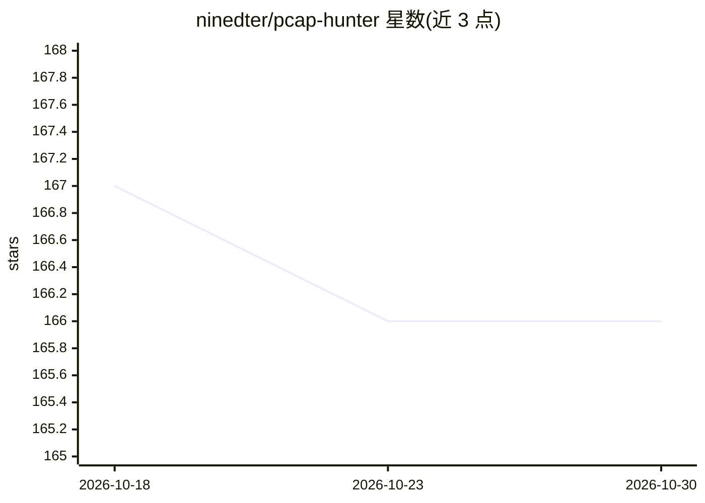

# ninedter/pcap-hunter

⭐ 166 · Python · MIT · 推送 2026-10-29 · [GitHub](https://github.com/ninedter/pcap-hunter) · 个人维护 · 中文 README

**面向 SOC/DFIR 分析师的 PCAP 威胁狩猎工作台**

以 Zeek、Tshark、PyShark 三引擎解析 PCAP 的威胁狩猎工作台：提供 React 前端工作台，覆盖地理流量地图、C2/beacon 检测、JA3 指纹、数据外泄检测、MITRE ATT&CK 假设映射、VirusTotal/GreyNoise 等 OSINT 富化、IOC 三层评分与跨指标贝叶斯相关性合成、多文件批处理与案件管理。LLM 为可选报告生成模块，支持 LM Studio 本地、OpenAI 与 Anthropic 云端后端，9 种语言报告；LLM 不可用时确定性证据仍可用。通过 Docker 构建 React 工作台并保留 Python 分析引擎，也支持源码运行。

## 筛选速览

| 维度 | 判定 | 备注 |
|---|---|---|
| AI 角色 | `ai-enhanced` | 去掉 AI 部分产品仍成立 |
| 许可风险 | `permissive` | MIT |
| 部署形态 | `self-host` | docker 或自建部署 |
| 模型依赖 | locked-api |  |
| 硬件要求 | — | 无带数字的原话,不猜 |
| 安装摩擦 | `low` | 无编译、无系统依赖或容器化 |
| 成熟度 | — | 结构信号不足 |

## 能力要点

- Zeek + Tshark + PyShark 多引擎解析与并发流水线
- IOC 三层信号评分与贝叶斯跨指标相关性合成
- MITRE ATT&CK 假设映射与 Navigator 层导出
- 可选 LLM 报告：LM Studio 本地 / OpenAI / Anthropic，9 种语言

## 适用场景

- 对网络抓包做 C2、beacon 与数据外泄检测
- 将网络证据映射到 MITRE ATT&CK 假设并记录分析员判定
- 批量分析多份 PCAP 并以案件形式长期跟踪调查
- 在隔离环境中用本地 LLM 生成威胁报告

## 场景标签

`网络安全` · 领域:学习与行业

## 证据(README 行号)

> L12: The latest workbench keeps the full packet-analysis depth of **Zeek**, **Tshark**, and **PyShark**, then adds an an
> L140: - **LLM-Optional Evidence View** — parsed packet, flow, IOC, correlation, stage, and warning evidence remains visi

## 星数曲线

2026-10-18 167 → 2026-10-30 166（-1）

---
*卡片 v1 · prompt 1.4 · 生成 2026-10-23 · 置信度 high · 依据 README sha `42ca6b2db27a` · [字段定义](../../DATASET.md)*
