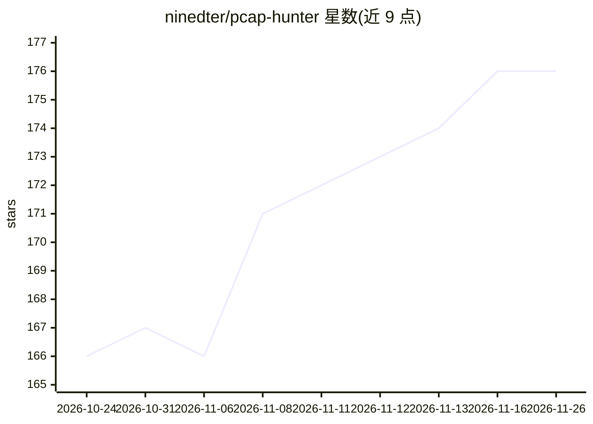

# ninedter/pcap-hunter

⭐ 176 · Python · MIT · 推送 2026-11-15 · [GitHub](https://github.com/ninedter/pcap-hunter) · 个人维护 · 中文 README

**面向 SOC/DFIR 分析师的 PCAP 威胁狩猎工作台**

把原始 PCAP 转为可操作的威胁情报的加密流量分析工作台：内置 Zeek、tshark、PyShark 十阶段分析管线，提供 C2 beacon 检测、JA3 指纹、DNS 隧道与数据外泄检测、IOC 三层评分与贝叶斯独立性关联聚合、MITRE ATT&CK 假设映射，以及 VirusTotal/AbuseIPDB/GreyNoise/OTX/Shodan 情报富化。v3 为 React 工作台，含地理流量图、流量回放、案件管理与 9 语言报告。LLM 报告为可选功能，本地 LM Studio 或云端 OpenAI/Anthropic 均可，LLM 不可用时确定性证据视图仍完整可用。

## 筛选速览

| 维度 | 判定 | 备注 |
|---|---|---|
| AI 角色 | `ai-enhanced` | 去掉 AI 部分产品仍成立 |
| 许可风险 | `permissive` | MIT |
| 部署形态 | `self-host` | docker 或自建部署 |
| 模型依赖 | locked-api |  |
| 硬件要求 | — | 无带数字的原话,不猜 |
| 安装摩擦 | `low` | 无编译、无系统依赖或容器化 |
| 成熟度 | — | 结构信号不足 |

## 能力要点

- Zeek + tshark + PyShark 十阶段管线，DNS/TLS/beaconing/HTTP carving 四路并发
- 三层 IOC 评分（OSINT 确证/行为/上下文）与 1−Π(1−wᵢsᵢ) 关联公式
- MITRE ATT&CK 假设工作区，可导出 Navigator layers
- 多后端 LLM 报告：LM Studio 本地分段生成、OpenAI/Anthropic 全上下文单次生成

## 适用场景

- 上传 PCAP 批量检测 C2 回连、信标与数据外泄行为
- 对 IOC 做 VirusTotal/AbuseIPDB 等多源情报富化与分级
- 把网络证据映射为 ATT&CK 假设并导出报告与 Navigator 层
- 跨会话持久化管理事件调查案件与证据清单

## 场景标签

`网络安全` · 领域:学习与行业

## 证据(README 行号)

> L10: **PCAP Hunter** is an AI-enhanced threat hunting workbench that bridges manual packet analysis and automated securi
> L12: The latest workbench keeps the full packet-analysis depth of **Zeek**, **Tshark**, and **PyShark**, then adds an an
> L146: - **LLM-Optional Evidence View** — parsed packet, flow, IOC, correlation, stage, and warning evidence remains visi

## 星数曲线

2026-10-24 166 → 2026-11-26 176（+10）

---
*卡片 v1 · prompt 1.4 · 生成 2026-11-26 · 置信度 high · 依据 README sha `7d19c6aafd6a` · [字段定义](../../DATASET.md)*
