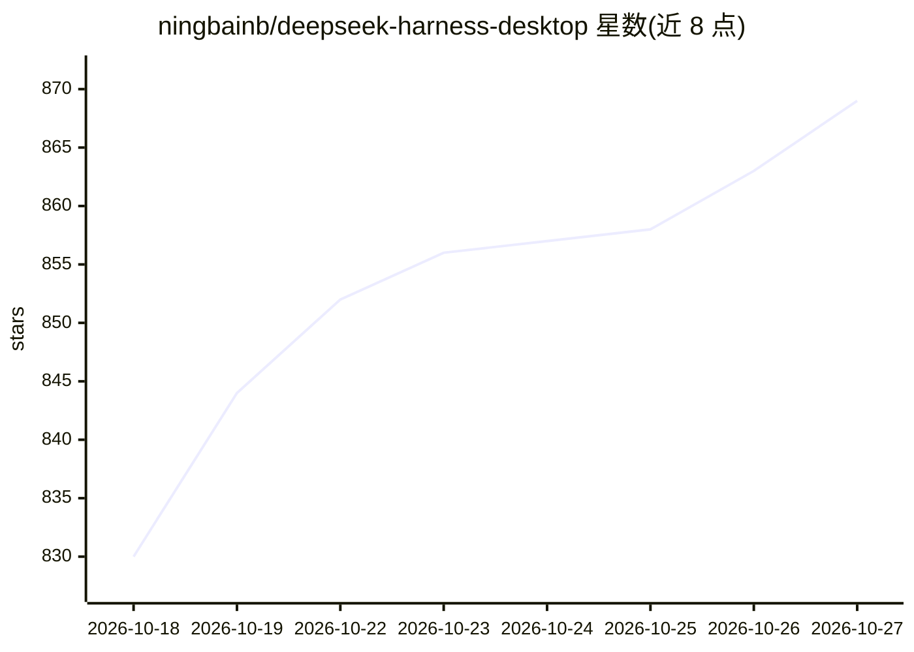

# ningbainb/deepseek-harness-desktop

⭐ 869 · JavaScript · BSD-3-Clause · 推送 2026-10-26 · [GitHub](https://github.com/ningbainb/deepseek-harness-desktop) · [官网](https://ningbainb.github.io/deepseek-harness-desktop/) · 个人维护 · 中文 README

**DeepSeek Harness 的开源三平台 AI 编程桌面客户端**

社区维护的开源 AI 编程桌面应用：将公开的 DSH Runtime 与 Web UI 封装为 Windows/macOS/Linux 桌面宿主，提供 AI 对话与代码修改、任务看板与定时自动化、Git 图谱与 SCM、文件预览、SSH/SFTP 远程开发、手机远程控制、QQ Bot 接入、插件与 Skills 生态、多套主题皮肤与桌宠。Windows x64 为正式版（安装包内置 Node.js、Git、DSH），macOS arm64 与 Linux x64 为 Preview 且未签名。非 DeepSeek 官方客户端，BSD-3-Clause 许可。

## 筛选速览

| 维度 | 判定 | 备注 |
|---|---|---|
| AI 角色 | `ai-native` | 本体是模型或模型工具 |
| 许可风险 | `permissive` | BSD-3-Clause |
| 部署形态 | `desktop` | 安装包/桌面程序 |
| 模型依赖 | locked-api |  |
| 硬件要求 | — | 无带数字的原话,不猜 |
| 安装摩擦 | `low` | 无编译、无系统依赖或容器化 |
| 成熟度 | `idea` | |

## 能力要点

- 任务看板可直接交给 DSH Agent Session 执行并记录 Task Run 与 Evidence
- 支持 SSH/SFTP/端口转发/多主机集群与手机远程控制工作区
- 统一扫描项目、用户与 Agents 来源的 Skills 并支持插件市场
- Browser Use 与 Computer Use 操控默认关闭，操作需逐次审批

## 适用场景

- 在桌面端一体完成 AI 编程、Git 与文件管理工作流
- 通过手机或 QQ 远程连接本机 Harness 工作区
- 用任务看板与定时任务做周期性开发维护自动化

## 场景标签

`编码 Agent` `AI 助手` · 领域:编码与开发

## 证据(README 行号)

> L35: DeepSeek 官方尚未正式发布独立 Desktop 产品；本项目把公开的官方 **DSH Runtime、Web UI 与官方仓库中的 Desktop 能力边界** 融合为 Windows、macOS 与 Linux 桌面应用
> L204: 桌面版直接运行 DeepSeek Harness Web Surface，并由桌面宿主管理本地 DSH Runtime。

## 星数曲线

2026-10-18 830 → 2026-10-27 869（+39）

---
*卡片 v1 · prompt 1.4 · 生成 2026-10-21 · 置信度 high · 依据 README sha `0a17fd5d43c3` · [字段定义](../../DATASET.md)*
