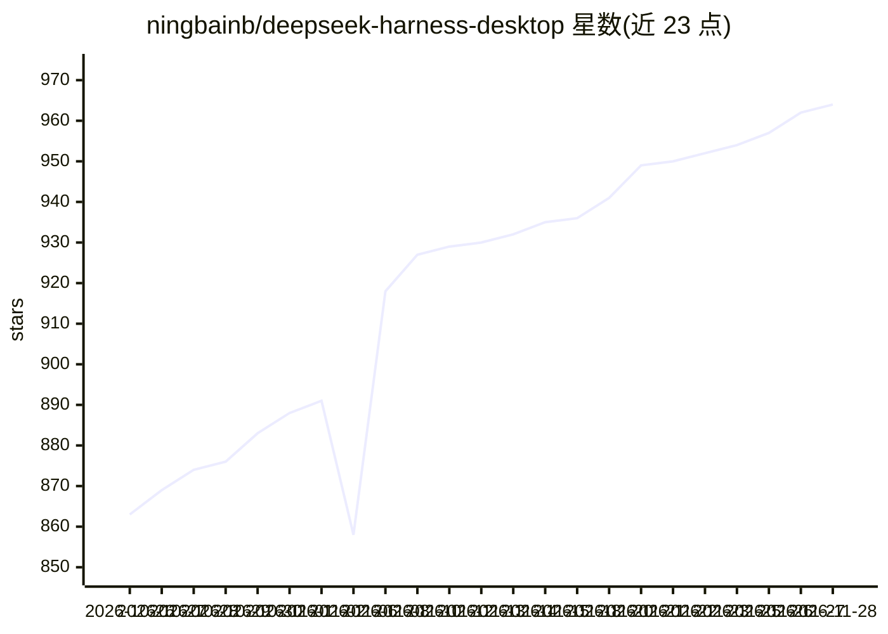

# ningbainb/deepseek-harness-desktop

⭐ 964 · JavaScript · BSD-3-Clause · 推送 2026-11-26 · [GitHub](https://github.com/ningbainb/deepseek-harness-desktop) · [官网](https://ningbainb.github.io/deepseek-harness-desktop/) · 个人维护 · 中文 README

**DeepSeek Harness 的桌面 GUI 客户端，打包零配置运行环境**

基于官方 DSH Runtime 的社区开源桌面工作台，用 Electron 封装 DeepSeek Harness Web Surface 并统一管理本地运行时：AI 对话与代码修改、文件浏览与 Git 操作、Skills 与插件市场、任务看板交给真实 DSH Agent Session 执行、SSH/手机远程接入，以及 15 套主题皮肤与桌宠。安装包内置 Node.js、Git、pnpm 与 DSH，无需手动准备组件；按 BSD-3-Clause 发布，Windows 为正式版，macOS/Linux 为未签名 Preview。

## 筛选速览

| 维度 | 判定 | 备注 |
|---|---|---|
| AI 角色 | `ai-ecosystem` | LLM/agent 周边工具 |
| 许可风险 | `permissive` | BSD-3-Clause |
| 部署形态 | `desktop` | 安装包/桌面程序 |
| 模型依赖 | locked-api |  |
| 硬件要求 | — | 无带数字的原话,不猜 |
| 安装摩擦 | `low` | 无编译、无系统依赖或容器化 |
| 成熟度 | — | 结构信号不足 |

## 能力要点

- 零配置安装包内置 Node.js、Git、pnpm 与 DSH Runtime
- 任务看板支持定时任务并记录 Task Run 与 Evidence
- SSH/手机远程/Web Terminal/SFTP/端口转发/多主机集群
- Browser Use 与 Computer Use 智能操控（默认关闭、逐次审批）

## 适用场景

- 不想手动配 Node/Git，安装即用的 Harness 开发环境
- 通过手机或 QQ Bot 远程控制本机 AI 编程会话
- 用任务看板管理周期性开发与自动化任务

## 场景标签

`编码 Agent` `AI 助手` · 领域:编码与开发

## 证据(README 行号)

> L7: DeepSeek Harness Desktop 是基于官方 DSH 的社区开源桌面工作台，用于对话、项目、插件和任务自动化。
> L236: 桌面版直接运行 DeepSeek Harness Web Surface，并由桌面宿主管理本地 DSH Runtime。
> L26: 支持 Windows 10 / 11 x64、macOS 13+ Apple Silicon arm64 Preview 和 Linux x64 Preview。安装包包含 Node.js 与 DSH。Windows 内置 Git

## 星数曲线

2026-10-26 863 → 2026-11-28 964（+101）

---
*卡片 v1 · prompt 1.4 · 生成 2026-11-24 · 置信度 high · 依据 README sha `30d2cfd187b8` · [字段定义](../../DATASET.md)*
