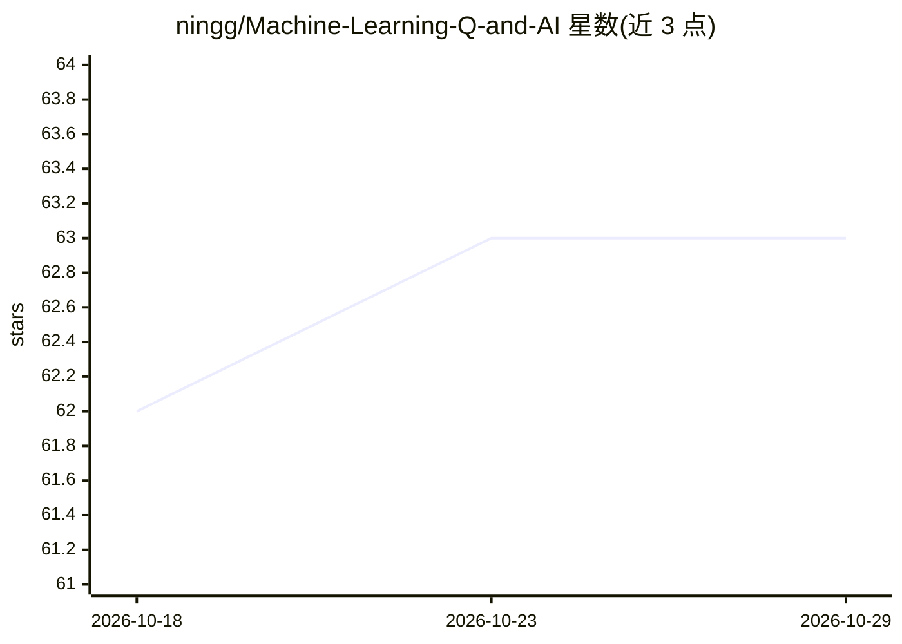

# ningg/Machine-Learning-Q-and-AI

⭐ 63 · Python · NOASSERTION · 推送 2026-05-14 · [GitHub](https://github.com/ningg/Machine-Learning-Q-and-AI) · [官网](http://ningg.top/Machine-Learning-Q-and-AI/) · 个人维护 · 中文 README

**大模型技术要点的中文批注学习教程（30讲）**

基于《30 Essential Questions and Answers on Machine Learning and AI》整理的系统性学习资料：将原书网页内容转录为 Markdown 存储在 GitHub，附加中文批注与中英术语对照，覆盖神经网络与深度学习、计算机视觉、NLP、生产部署、模型评估五部分共 30 章。通过 GitHub Pages 在线阅读，并提供 PDF 版本下载。维护者说明原因为纸质版印刷质量问题与电子版需求，另附 4 个转录脚本的说明及 Docsify 建站、公式渲染等附录。

## 筛选速览

| 维度 | 判定 | 备注 |
|---|---|---|
| AI 角色 | `ai-knowledge` | 知识聚合/清单类 |
| 许可风险 | `none` | NOASSERTION |
| 部署形态 | `library` | 以包/库形式分发 |
| 模型依赖 | — | README 未给出锁定关系 |
| 硬件要求 | — | 无带数字的原话,不猜 |
| 安装摩擦 | `low` | 无编译、无系统依赖或容器化 |
| 成熟度 | — | 结构信号不足 |

## 能力要点

- 30 章内容覆盖深度学习、CV、NLP、部署与评估五部分
- 原文转录为 Markdown 并附加中文批注与中英术语对照
- GitHub Pages 在线阅读与 PDF 下载
- 附录含网页转 md 的 4 个处理脚本说明

## 适用场景

- 系统学习大模型与机器学习核心技术要点
- 对照英文术语理解 AI 领域概念
- 用 AI 工具辅助阅读电子版教程内容

## 场景标签

`教程课程` · 领域:学习与行业

## 证据(README 行号)

> L21: 本项目是系统性学习大模型技术要点的教程，基于原始的 *《30 Essential Questions and Answers on Machine Learning and AI》* ，进行中文批注，增强可读性。
> L25: 1. 系统性学习：大模型技术要点的教程

## 星数曲线

2026-10-18 62 → 2026-10-29 63（+1）

---
*卡片 v1 · prompt 1.4 · 生成 2026-10-24 · 置信度 mid · 依据 README sha `1cc416966e78` · [字段定义](../../DATASET.md)*
