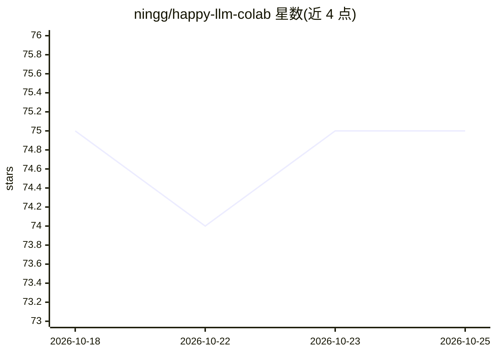

# ningg/happy-llm-colab

⭐ 75 · Python · NOASSERTION · 推送 2026-05-24 · [GitHub](https://github.com/ningg/happy-llm-colab) · [官网](http://ningg.top/happy-llm-colab/) · 个人维护 · 中文 README

**happy-llm 教程的 Colab 笔记本版本，免费 GPU 在线实践**

将开源教程项目 happy-llm 的内容转换为 ipynb 格式，供用户在 Google Colab 上直接点击链接并运行对应章节代码，利用 Colab 免费 GPU 实践。内容覆盖 NLP 基础、Transformer 搭建、预训练语言模型、动手实现 LLaMA2、LoRA/QLoRA 微调及 RAG/Agent 应用等章节，并附外部大模型学习博客索引。通过脚本自动从原始项目生成笔记本，与 happy-llm 保持周级别同步更新。

## 筛选速览

| 维度 | 判定 | 备注 |
|---|---|---|
| AI 角色 | `ai-knowledge` | 知识聚合/清单类 |
| 许可风险 | `none` | NOASSERTION |
| 部署形态 | `library` | 以包/库形式分发 |
| 模型依赖 | — | README 未给出锁定关系 |
| 硬件要求 | — | 无带数字的原话,不猜 |
| 安装摩擦 | `low` | 无编译、无系统依赖或容器化 |
| 成熟度 | — | 结构信号不足 |

## 能力要点

- 将 happy-llm 转为 ipynb，在 Colab 直接运行对应章节代码
- 覆盖 Transformer 搭建、LLaMA2 实现、LoRA/QLoRA 微调、RAG/Agent 等章节
- 提供脚本自动生成笔记本并与源项目周级别同步

## 适用场景

- 在 Colab 免费 GPU 上动手实践 happy-llm 教程代码
- 系统学习 NLP 基础到大模型训练与微调的完整路径
- 查阅社区贡献的大模型学习博客与笔记

## 场景标签

`教程课程` · 领域:学习与行业

## 证据(README 行号)

> L17: **背景**：原始项目happy-llm 不是 `ipynb` 格式文件，无法直接利用 `colab` 运行，效率低。
> L19: **焦点**：编写脚本，生成 happy-llm-colab (**happy-llm 的 colab 版本项目**)，用于在 colab 上直接实践 happy-llm 代码。
> L30: |第一章 NLP 基础概念|什么是 NLP、发展历程、任务分类、文本表示演进|✅|

## 星数曲线

2026-10-18 75 → 2026-10-25 75（+0）

---
*卡片 v1 · prompt 1.4 · 生成 2026-10-24 · 置信度 mid · 依据 README sha `a9587c41fa5b` · [字段定义](../../DATASET.md)*
