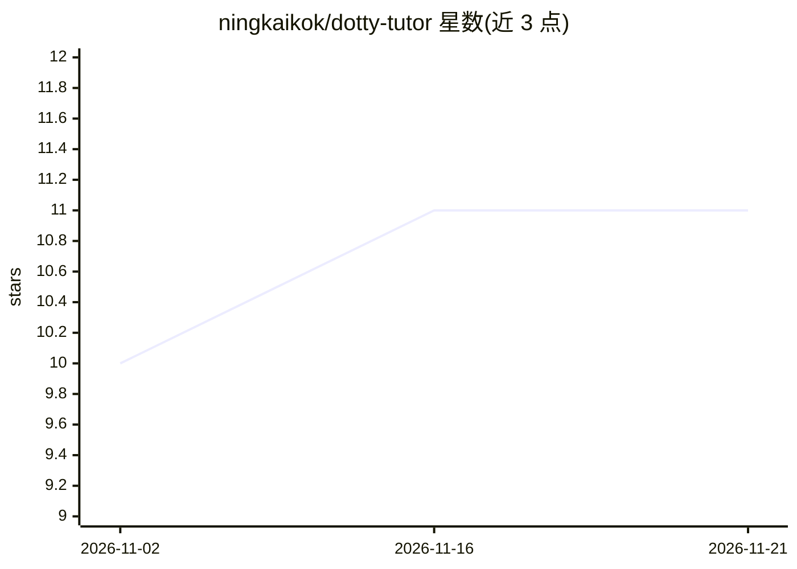

# ningkaikok/dotty-tutor

⭐ 11 · Python · Apache-2.0 · 推送 2026-10-24 · [GitHub](https://github.com/ningkaikok/dotty-tutor) · 个人维护 · 中文 README

**面向中文教材场景的 AI 数字化出题与互动练习平台**

将 PDF/扫描教材经 MinerU/pypdf 双路 OCR 结构化，生成带来源与审校记录的互动课件与七种题型练习；文本+视觉多模型生成路径配合质量门禁与不可变审计。学生端提供分层提示、错题拍照录题与多轮陪练闭环，教师端支持班级掌握度统计与作业计划。FastAPI+PostgreSQL JSONB+React 19，MVP 阶段，适合本地体验与受控内测，登录鉴权与多租户未实现。

## 筛选速览

| 维度 | 判定 | 备注 |
|---|---|---|
| AI 角色 | `ai-native` | 本体是模型或模型工具 |
| 许可风险 | `permissive` | Apache-2.0 |
| 部署形态 | `self-host` | docker 或自建部署 |
| 模型依赖 | local-ok | 支持本地模型 |
| 硬件要求 | — | 无带数字的原话,不猜 |
| 安装摩擦 | `low` | 无编译、无系统依赖或容器化 |
| 成熟度 | `idea` | |

## 能力要点

- MinerU/pypdf 双路 OCR 与多模型生成路径、质量门禁
- 七种题型互动、分层 Help、断网可恢复学习会话
- AI 错题陪练：拍照录题→归因→多轮陪练→变式验证
- 语音三级回退：Azure Speech → Qwen3-TTS → Web Speech

## 适用场景

- 把 PDF/扫描教材转成带来源审校的互动课件
- 学生拍照错题后进行多轮陪练和变式掌握验证
- 教师基于班级掌握度证据生成并审阅作业计划

## 场景标签

`RAG` `OCR` `文档解析` · 领域:知识与检索

## 证据(README 行号)

> L11: Dotty Tutor 将 PDF 或扫描教材制作成带来源与审校记录的互动课件，试卷保留原题处理与结构化题目生产；
> L30: 只暴露学习本身，不暴露 OCR、模型和上传配置：互动课件、七种题型交互、分层 Help、可编程课程播放器，
> L40: 拍照录题、错误原因归因、单题多轮陪练线程、变式掌握验证和版本化复习策略（旧数据兼容 1/3/7 天），形成完整闭环。

## 星数曲线

2026-11-02 10 → 2026-11-21 11（+1）

---
*卡片 v1 · prompt 1.4 · 生成 2026-11-18 · 置信度 high · 依据 README sha `60399ebc6803` · [字段定义](../../DATASET.md)*
